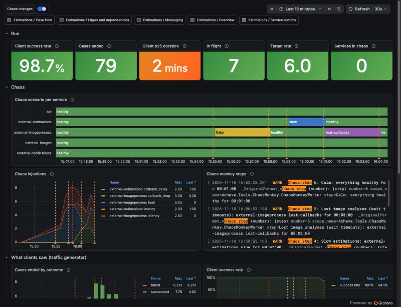

# Chaos

Every fake external system, and the Api's callback endpoints, can misbehave on demand: fail requests, answer slowly, or (for the two systems that call back) lose, duplicate or delay their callbacks. A scenario is switched at run time, without a restart, from the Aspire dashboard or over HTTP. It only works in Development.

The code is in [src/Common/Acheve.Common.Chaos](../src/Common/Acheve.Common.Chaos). Faults and latency use Polly's chaos strategies (Simmy) in a middleware; the callback misbehaviour is decided by `ChaosState.PlanCallback()` in the fakes that call back.

## Scenarios

| Scenario | What happens | What to expect |
| --- | --- | --- |
| `healthy` | Nothing is injected (the default). | |
| `flaky` | 30% of requests fail with 503 and 20% wait 2 s first. | The callers' HTTP retries hide most of it: more retries and latency, few failed cases. |
| `slow` | Every request waits 5 s; callbacks come 20 s later than usual. | Slower cases and `StillAwaiting…` checks in the saga, but no failures. |
| `down` | Every request fails with 503. | Retries run out: `UnableTo…` messages, failed images or estimations, failed client notifications. |
| `lost-callbacks` | Half of the accepted work never calls back. | The saga's wait timeouts (about 120 s) give up on those images or estimations. |
| `duplicate-callbacks` | Half of the callbacks are sent twice. | The saga ignores the second one and logs a warning; cases complete normally. |

`lost-callbacks` and `duplicate-callbacks` only apply to `external-imageprocess` and `external-estimations`. On the Api, the chaos only applies to `/callbacks` (the `Chaos:Paths` setting), so clients can still start cases and read their state. Health checks and `/chaos` itself are never broken.

## Switching a scenario

- **Aspire dashboard**: open a resource's actions (**…**) → **Commands** → **Chaos: \<scenario\>**. The external systems have them in the external AppHost's dashboard, and the Api in the application's.
- **HTTP**, on each service:
  - `GET /chaos`: the settings in force and the scenario names.
  - `POST /chaos/scenarios/{name}`: switch to a named scenario.
  - `PUT /chaos`: custom settings (scenario `custom`), for example `{"faultRate": 0.5, "faultStatusCode": 500}` or `{"callbackDropRate": 1}`. Rates go from 0 to 1.
- **At start**: set `Chaos:Scenario` (for example the environment variable `Chaos__Scenario=flaky`).

## Chaos monkey

[Acheve.Tools.ChaosMonkey](../src/Tools/Acheve.Tools.ChaosMonkey) switches the scenarios for you over time. It runs in the application's AppHost but doesn't start with it: press **Start** on `chaosmonkey` in the Aspire dashboard, ideally with the [traffic generator](traffic.md) running too. When it stops, or its timeline ends, it puts every target back to `healthy`.

At each step it sets the step's scenarios and switches every target the step doesn't name back to `healthy`, then waits the step's duration. Targets: `api`, `external-images`, `external-imageprocess`, `external-estimations` and `external-notifications`. It refuses to start on a target or scenario that doesn't exist (for example `lost-callbacks` on the Api).

Two modes, in the `ChaosMonkey` section of its [appsettings.json](../src/Tools/Acheve.Tools.ChaosMonkey/appsettings.json):

- **`Timeline`** (default): named steps in order, repeated when `Repeat` is on. The shipped timeline takes about 18 minutes: a healthy baseline, flaky image analysis, slow estimations, lost image analyses, the client endpoint down, flaky callbacks with duplicate estimations, and a recovery. A step looks like:

  ```json
  { "Name": "Slow estimations", "Duration": "00:02:00", "Scenarios": { "external-estimations": "slow" } }
  ```

- **`Random`**: a random scenario on 1 to `MaxTargets` random targets for a random time between `MinDuration` and `MaxDuration`, then `HealthyGap` with everything healthy, over and over.

Its logs show each step (`Chaos step 2: Flaky image analysis …`), and the meter `Acheve.ChaosMonkey` counts the switches (`chaos_monkey_switches_total` by target, scenario and result) and steps. What each service is actually in comes from the services themselves (`chaos_scenario_active`). A target that can't be reached (for example when the external systems' AppHost isn't running) is logged and counted as failed, and the step goes on.

## Seeing it

- **Metrics** (meter `Acheve.Chaos`): `chaos_injections_total` by `chaos_kind` (`fault`, `latency`, `callback_drop`, `callback_duplicate`, `callback_delay`) and `chaos_scenario`; `chaos_scenario_active` is 1 for the scenario in force and 0 for the others.
- **Traces**: the request span gets a `chaos.injected` tag with the kind.
- **Logs**: a warning when the scenario really changes (switching to the scenario already in force logs nothing) and a line for each injection, with the scenario.

To see a scenario's effect on many cases, run the [traffic generator](traffic.md) while it is on.

### The Chaos run dashboard

The Grafana dashboard **Estimations / Chaos run** puts it all together: one row per service with the scenario it was in, every scenario change marked on all the charts, the chaos monkey's steps, and next to them what clients saw (the traffic generator's outcomes, success rate, duration and load) and what the saga saw.



In this run the image analysis was `flaky` from 15:55 to 15:58: about a quarter of the calls to it failed, but the retries hid it and every case succeeded. Then the estimations were `slow`, and then the image analysis lost callbacks: cases waited for the saga's timeouts, the p95 duration went up to about 2 minutes and some cases failed.
