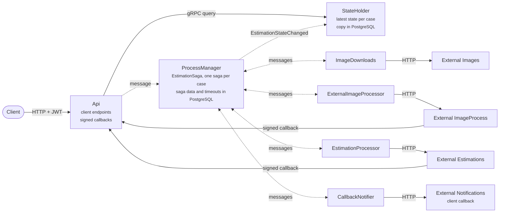
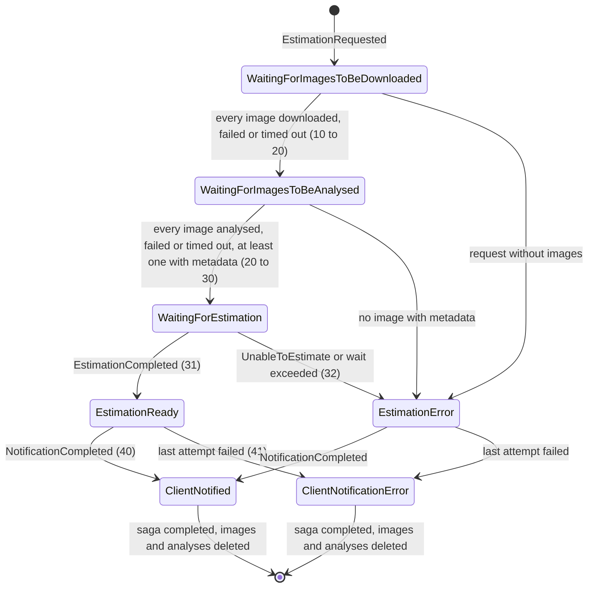
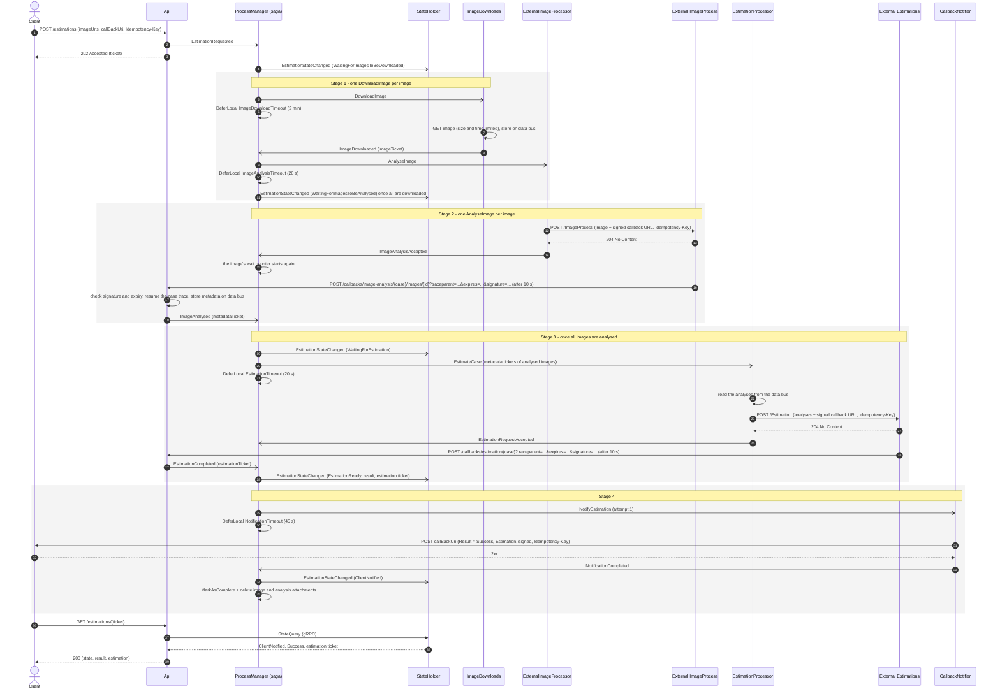
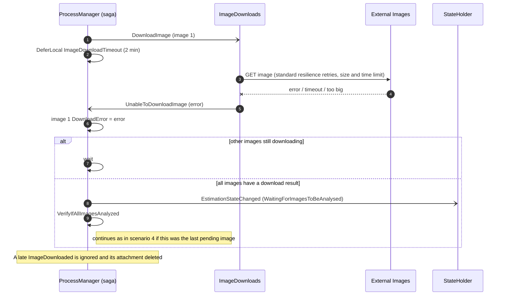
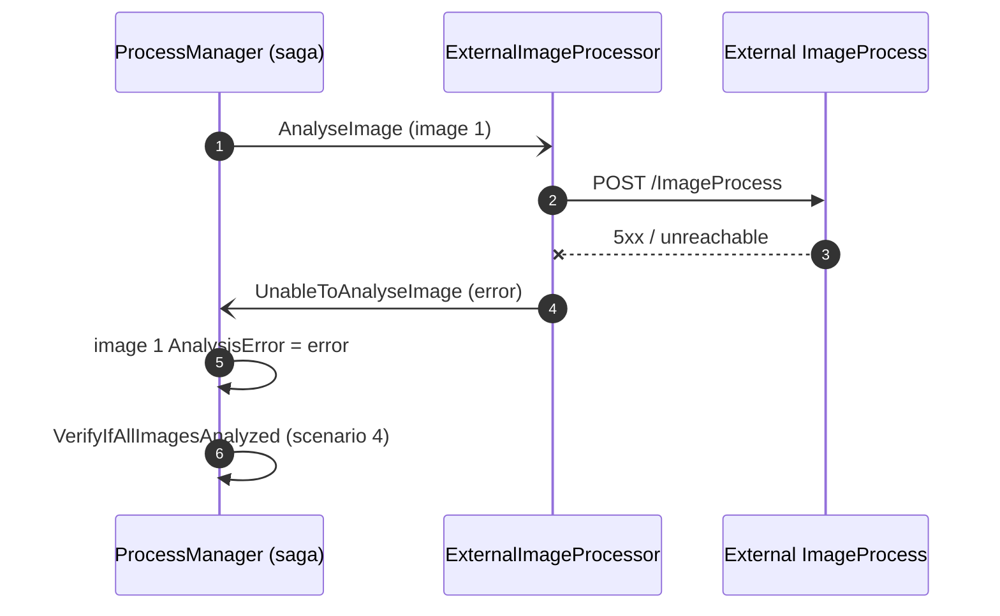
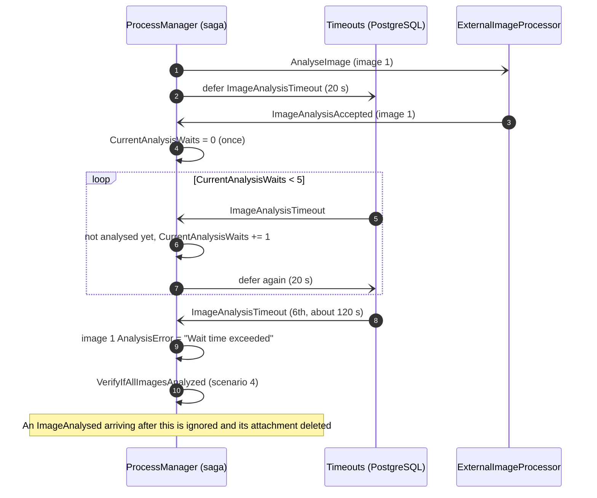
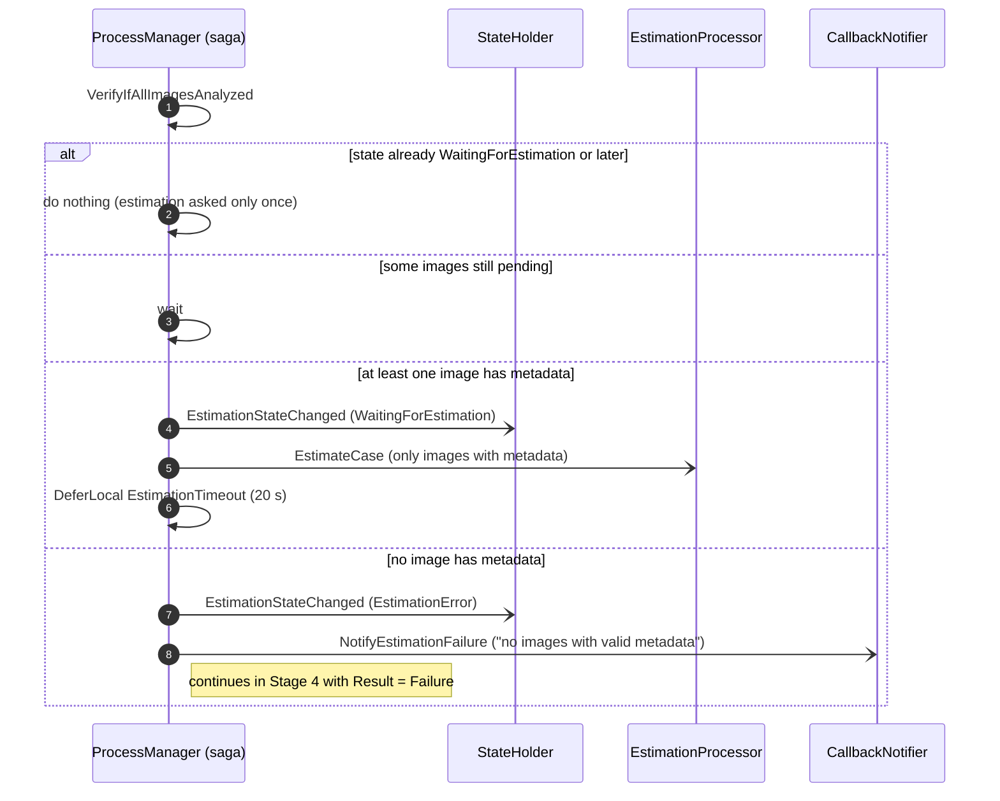
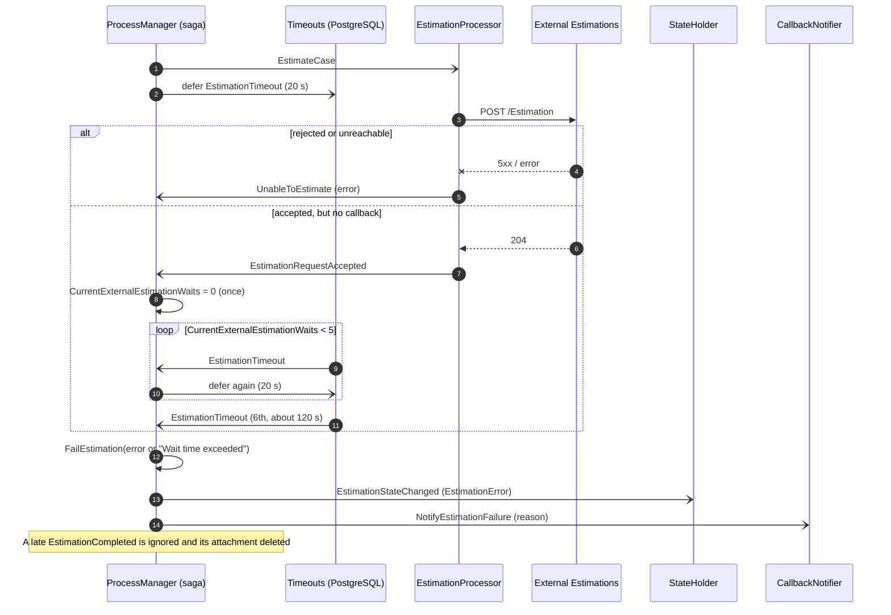
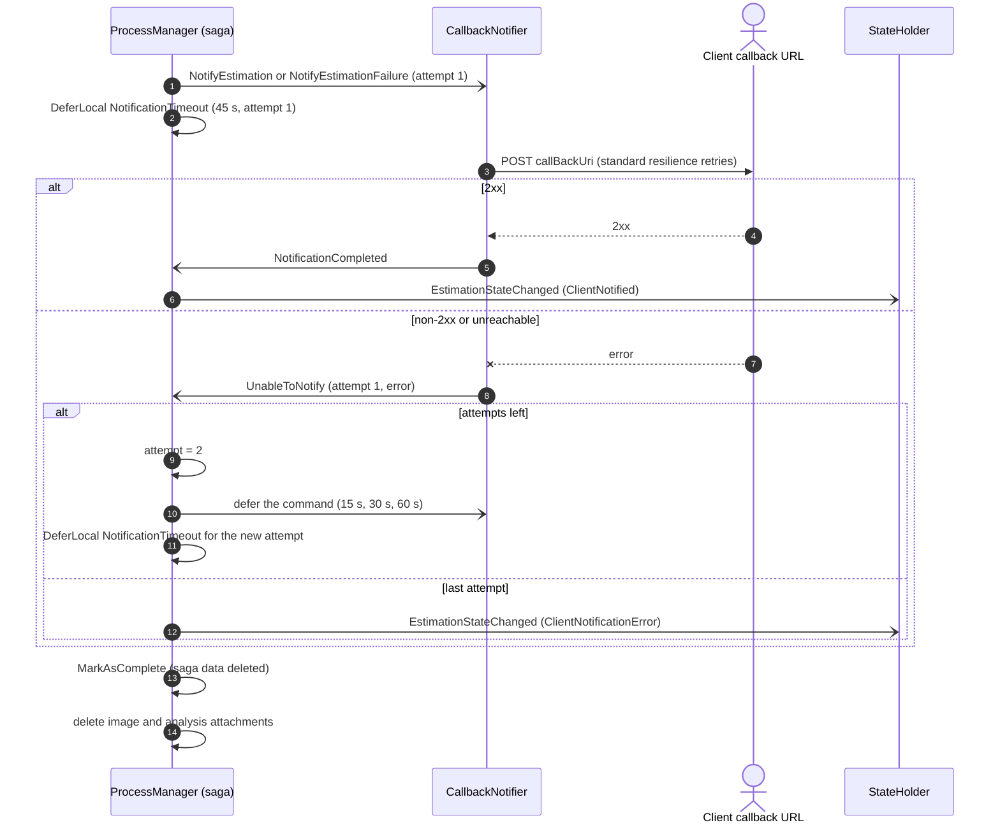

# Estimations — Messages Flow

How a case moves through the system, which messages each step sends, and what happens when something fails.

## Overview

A client posts a list of image URLs and a callback URL; the system downloads each image, has an external service analyse it, asks another external service for one estimation built from the analyses, and posts the result to the client's callback URL. The client gets a ticket straight away and can poll its state at any time.

The work runs as four stages, all driven by one process manager (the `EstimationSaga`, one saga per case):

1. **Download** every image (one command per image, in parallel).
2. **Analyse** every downloaded image with the external image service, which answers later through a signed callback.
3. **Estimate** the case with the external estimation service, which also answers through a signed callback.
4. **Notify** the client with the estimation or the error, retrying when the client can't be reached.

Services never call each other directly except over HTTP at the edges (external systems, client callback) and gRPC for the state query. Everything inside travels as Rebus messages over RabbitMQ. Images, analyses and estimations are stored as data bus attachments in the shared `.data/databus` folder; messages only carry their ticket (the attachment id).

**The saga owns every wait.** It starts a timeout in the same handler that sends a command (download, analysis, estimation, notification), so a command that is never answered, for example because it ended in the error queue, still ends. The `…Accepted` messages the workers send only give the external service a fresh wait.



Dotted arrows are RabbitMQ messages; solid arrows are HTTP or gRPC calls. The ProcessManager sends a command to one worker per external system and gets a result message back; the external image and estimation services answer later through signed callbacks on the Api, which turns them into messages for the saga.

## Components

Seven application services share RabbitMQ and the data bus folder; four fake external systems stand in for the outside world. Two Aspire AppHosts start them: [src/Aspire/Acheve.AppHost](../src/Aspire/Acheve.AppHost/AppHost.cs) runs the application and its infrastructure, and [src/Aspire/Acheve.External.AppHost](../src/Aspire/Acheve.External.AppHost/AppHost.cs) runs the fakes on fixed ports (https://localhost:5001-5004). The application only knows the fakes' URLs, from the `ExternalSystems` settings of its AppHost.

Like real external systems, the fakes don't take part in the application's traces: they ignore incoming trace headers and send none in their callbacks. Each case's trace continues across a callback through the `traceparent` the application puts in the callback URL, and the fakes' own requests show up as separate traces.

| Service | Input queue | Role |
| --- | --- | --- |
| Api | none (one-way client) | Client entry point: `POST /estimations` starts a case, `GET /estimations/{ticket}` returns its state, result and estimation. Also receives the signed callbacks from the external image and estimation services and turns them into messages. |
| ProcessManager | `processmanager` | Runs `EstimationSaga`. Holds the case data in PostgreSQL (`saga_data`) and its deferred timeout messages (`timeouts`). The only service that decides what happens next. Also runs the data bus sweeper. |
| ImageDownloads | `imagedownloads` | Downloads one image from its URL (size and time limited) and stores it on the data bus. |
| ExternalImageProcessor | `imageprocess` | Sends one image to the external image service with a signed callback URL. |
| EstimationProcessor | `externalestimations` | Reads the analyses from the data bus and sends them to the external estimation service with a signed callback URL. |
| CallbackNotifier | `callbacknotifications` | Posts the final result (success or failure) to the client's callback URL, signed when a key is configured. |
| StateHolder | `stateholder` | Keeps the latest state, result and estimation ticket of every case; the Api queries it over gRPC. A copy lives in PostgreSQL (`stateholderdb`) and is loaded at startup. |
| External.Images | — | Serves the sample images over HTTP. |
| External.ImageProcess | — | Accepts an image, waits 10 s, posts the metadata to the callback URL. Runs up to 20 jobs at a time. Accepts the same `Idempotency-Key` only once. |
| External.Estimations | — | Accepts the analyses, waits 10 s, posts the estimation to the callback URL. Runs up to 20 jobs at a time. Accepts the same `Idempotency-Key` only once. |
| External.Notifications | — | Plays the client: checks the notification signature (when a key is set) and receives the final notification. |

## Messages

Every message carries the `CaseNumber` (the ticket), which correlates it to its saga. Messages are sent to one queue (type-based routing), never published. Commands are named for the action they ask for; events say what happened. Rows follow the order of the flow.

| Stage | Message | From → to | Meaning |
| --- | --- | --- | --- |
| Start | `EstimationRequested` | Api → ProcessManager | Starts a new saga with the client id, callback URL and image URLs. |
| Any | `EstimationStateChanged` | ProcessManager → StateHolder | The case moved to a new state. Carries the result, failure reason, estimation ticket and skipped images known so far. |
| 1 Download | `DownloadImage` | ProcessManager → ImageDownloads | Command: download image *n*. One per image. |
| 1 Download | `ImageDownloaded` | ImageDownloads → ProcessManager | Image stored; carries its data bus ticket. |
| 1 Download | `UnableToDownloadImage` | ImageDownloads → ProcessManager | Download failed after the HTTP retries, was too big or too slow. |
| 1 Download | `ImageDownloadTimeout` | ProcessManager → itself (deferred 2 min) | The download never answered. |
| 2 Analyse | `AnalyseImage` | ProcessManager → ExternalImageProcessor | Command: send image *n* to the external image service. |
| 2 Analyse | `ImageAnalysisAccepted` | ExternalImageProcessor → ProcessManager | The external service accepted the image; it gets a fresh wait. |
| 2 Analyse | `UnableToAnalyseImage` | ExternalImageProcessor → ProcessManager | The external service rejected the image or could not be reached. |
| 2 Analyse | `ImageAnalysisTimeout` | ProcessManager → itself (deferred 20 s) | Timeout tick while waiting for the analysis. |
| 2 Analyse | `ImageAnalysed` | Api (callback) → ProcessManager | The analysis arrived; carries the metadata ticket. |
| 3 Estimate | `EstimateCase` | ProcessManager → EstimationProcessor | Command: ask for the estimation with the analysed images' metadata tickets. |
| 3 Estimate | `EstimationRequestAccepted` | EstimationProcessor → ProcessManager | The external service accepted the request; it gets a fresh wait. |
| 3 Estimate | `UnableToEstimate` | EstimationProcessor → ProcessManager | The external service rejected the request or could not be reached. |
| 3 Estimate | `EstimationTimeout` | ProcessManager → itself (deferred 20 s) | Timeout tick while waiting for the estimation. |
| 3 Estimate | `EstimationCompleted` | Api (callback) → ProcessManager | The estimation arrived; carries the estimation ticket. |
| 4 Notify | `NotifyEstimation` | ProcessManager → CallbackNotifier | Command: post the estimation to the client. Carries the `Attempt` and the skipped images. |
| 4 Notify | `NotifyEstimationFailure` | ProcessManager → CallbackNotifier | Command: post the failure reason to the client. |
| 4 Notify | `NotificationCompleted` | CallbackNotifier → ProcessManager | The client accepted the notification (2xx). |
| 4 Notify | `UnableToNotify` | CallbackNotifier → ProcessManager | The client callback failed after the HTTP retries; carries the `Attempt` and the error. |
| 4 Notify | `NotificationTimeout` | ProcessManager → itself (deferred) | The notifier never answered this attempt. |

The saga's own `…Timeout` messages live in the ProcessManager project; they are not part of the shared contract.

## Case states

A case moves through seven states (`EstimationStates`), always forward; the number is the enum value, and StateHolder keeps the highest one it has seen. `GET /estimations/{ticket}` returns the state name and, once the case has a result, `result` (`Success` or `Failure`); a ticket the client doesn't own answers `404`.



`ClientNotified` after `EstimationError` means the client was told about the failure, not that the case succeeded: read `result`. The estimation itself stays on the data bus (24 hours by default) so the client can still read it from the `GET` after a notification failed.

## Happy path

With every external call succeeding, a case with two images takes about 25 s: the external image and estimation services each answer after 10 s, and the client callback takes 2 s. The diagram shows one image; the download and analysis steps run once per image, in parallel.

The two fakes run their accepted jobs in the background, up to `BackgroundQueue:MaxConcurrency` at a time (20 by default), so each handles about 120 jobs a minute before jobs start to wait. Up to `BackgroundQueue:Capacity` jobs (100 by default) can wait; past that a new request blocks until there is room.



Arrows with an open head are asynchronous Rebus messages; arrows with a filled head are HTTP or gRPC calls; dashed arrows are responses. The pending `…Timeout` messages still fire later, see that the result is already there, and do nothing.

## Failure scenarios

A failure on one image never stops the case: the image is marked as failed, listed in `skippedImages`, and the case continues with the rest. The case fails only when no image can be analysed, or when the estimation or its wait fails. The client is notified either way.

To make any of these happen on demand, switch a [chaos scenario](chaos.md) on an external system or on the Api's callbacks.

### 1. An image can't be downloaded

The HTTP client retries first. A download also stops when the image is larger than `Downloads:MaxBytes` (20 MB) or takes longer than `Downloads:Timeout` (60 s), and a URL that isn't absolute http or https is rejected. If it still fails, the image counts as both downloaded and analysed (with an error) and is never sent for analysis. If even the worker's answer never arrives, `ImageDownloadTimeout` (2 min) does the same.



### 2. The external image service rejects an image

A non-2xx response, a connection error or a missing attachment ends the image's analysis with an error straight away.



### 3. The image analysis never arrives (timeout)

The wait starts when the saga sends `AnalyseImage`, so it also covers a worker that never answers. When the external service accepts the image, `ImageAnalysisAccepted` starts the counter again, so the service always gets the full wait. The saga checks every 20 s; after the first wait plus 5 more (about 120 s) it gives up on that image.



### 4. Deciding whether the case can be estimated

Once every image has a result (analysed, download error, analysis error or timeout), the saga either asks for the estimation with the images that have metadata, or fails the case.



### 5. The estimation fails or never arrives

The estimation has the same wait as an image analysis (started with `EstimateCase`, restarted by `EstimationRequestAccepted`), but any failure fails the whole case. A missing analysis attachment is reported as `UnableToEstimate` too.



### 6. Notifying the client

The notifier posts `Result = Success` with the estimation, or `Result = Failure` with the reason, plus the `skippedImages`. Each try has an `Attempt` number. The notifier's HTTP client retries first; if the call still fails (or the notifier doesn't answer within 45 s) the saga sends the command again after 15 s, then 30 s, then 60 s, up to 4 attempts. Only then the case ends as `ClientNotificationError`. Either way the saga ends and deletes the case's images and analyses; the estimation stays for the retention time.



The client can receive the same notification more than once (an HTTP retry, a saga retry after a slow answer). Every request carries the same `Idempotency-Key` (the case number), and a signature the client can check.

### 7. Duplicate, late and out-of-order messages

RabbitMQ delivers at least once and the external services may call back twice or after the saga stopped waiting. Each case is handled without repeating a step, and an attachment stored for a message the saga ignores is deleted.

```mermaid
sequenceDiagram
    autonumber
    participant X as Sender
    participant PM as ProcessManager (saga)
    participant SH as StateHolder

    X-)PM: same message again (same message id)
    PM->>PM: idempotent saga: already handled, resend its outgoing messages, skip the handler

    X-)PM: EstimationRequested for an existing case
    PM->>PM: not IsNew: ignore

    X-)PM: second ImageAnalysed / UnableToAnalyseImage for the same image
    PM->>PM: image already Analyzed: log, ignore, delete the extra attachment

    X-)PM: ImageAnalysed before ImageAnalysisAccepted
    PM->>PM: result stored; the late Accepted sees Analyzed and changes nothing

    X-)PM: EstimationCompleted when the case is not WaitingForEstimation
    PM->>PM: log, ignore, delete the extra attachment

    X-)PM: answer of an earlier notification attempt
    PM->>PM: attempt number differs: ignore

    PM-)SH: EstimationStateChanged arriving out of order
    SH->>SH: keep the higher state
```

Messages for a saga that already finished find no saga data and are dropped by Rebus. Their attachments, and any other attachment older than `DataBus:Retention` (24 hours), are deleted by the ProcessManager's data bus sweeper.

### 8. A callback with a bad signature or an old URL

The callback URLs given to the external services carry an HMAC signature tied to the case (and image), to the expiry time (`expires`, 30 minutes after the URL was built) and to the trace context in the URL. A call with a missing or wrong signature, one reused for another case or image, one whose `traceparent` or `expires` was changed, or one used after it expired, is rejected before any message is sent or attachment stored.

```mermaid
sequenceDiagram
    autonumber
    participant Caller
    participant Api
    participant PM as ProcessManager (saga)

    Caller->>Api: POST /callbacks/image-analysis/{case}/images/{id}?signature=bad
    Api->>Api: CallbackSigner.IsValidImageAnalysis = false
    Api-->>Caller: 401 Unauthorized
    Note over Api,PM: no ImageAnalysed is sent; the saga keeps waiting and may time out (scenario 3)
```

### 9. A request that is sent twice

`POST /estimations` accepts an `Idempotency-Key` header. The case number is derived from the client and the key, so a repeated request names the same case: the Api answers `202` with the same ticket, and sends no second `EstimationRequested` when the StateHolder already knows the case (a second copy racing past that check is ignored by the saga, see scenario 7). The body of the repeated request is not compared with the first one. Without the header every request starts a new case.

## Tracing

Each case can be followed as one distributed trace in the Aspire dashboard. `POST /estimations` returns the trace id as `OperationId`.

- Inside the system the trace travels on its own: HTTP and gRPC calls send the `traceparent` header, and Rebus copies it into every message, including deferred timeouts.
- The external image and estimation services don't send our trace context back, so it travels in the callback URL instead. `AnalyseImageHandler` and `EstimateCaseHandler` add the current `traceparent` as a query parameter, and `CallbackSigner` includes it in the signature, so nobody can attach a callback to someone else's trace.
- When a callback arrives, the Api checks the signature and then starts an `image analysis callback` or `estimation callback` span (`CallbackTracing`) whose parent is the span that sent the request. The message it sends (`ImageAnalysed` or `EstimationCompleted`) continues the case's trace.
- ASP.NET Core creates the callback's HTTP request span before our code runs, so that span stays in its own trace. The callback span links to it, and the dashboard shows the link.
- Callback spans are tagged with `estimation.case_number` (and `estimation.image_id` for an image).

A case's trace lasts as long as the case: about 25 s on the happy path and up to about 15 minutes when every wait times out and every notification attempt fails. If a production collector uses tail sampling, its decision wait must be longer than a case, or late spans end up in separate traces.

## Reliability rules

The saga is written so that any message can arrive twice, late or out of order without repeating a step.

| Mechanism | Where | What it guarantees |
| --- | --- | --- |
| Idempotent saga | `EnableIdempotentSagas()` in ProcessManager; `IdempotencyData` in `EstimationState` | The ids of handled messages and the messages each one sent are saved with the saga data. A redelivered message is skipped and its outgoing messages are resent, so a crash between saving the saga and sending never loses or repeats work. |
| Exclusive access | `EnforceExclusiveAccess()` | Two messages for the same case never run at the same time in one process. With several ProcessManager instances two messages for one case can still collide; Rebus retries the loser, and the saga data is saved with optimistic concurrency. |
| Saga-owned timeouts | `ImageDownloadTimeout`, `ImageAnalysisTimeout`, `EstimationTimeout`, `NotificationTimeout` + PostgreSQL `timeouts` table | Every command has a wait that starts when it is sent, so a command nobody answers still ends: a failed image, a failed case, or a retried notification. |
| Result guards | `Downloaded`, `Analyzed`, `WaitingForEstimation` checks in every handler | A second result for the same image or estimation (duplicate callback, result after a timeout) is logged and ignored, and the attachment it stored is deleted. |
| Start guard | `IsNew` check in `Handle(EstimationRequested)` | A redelivered request never restarts a running case. |
| Move-on-once guard | `State >= WaitingForEstimation` in `VerifyIfAllImagesAnalyzed` | The estimation is requested only once per case. |
| Attempt numbers | `Attempt` in `NotifyEstimation`, `NotificationCompleted`, `UnableToNotify`, `NotificationTimeout` | The answer or timeout of an earlier notification attempt can't trigger a retry of a later one. |
| Unknown image guard | `FindImage` returns null | A message naming an image the case doesn't have is dropped instead of failing on every retry. |
| Forward-only states | `State.AddOrUpdateState` in StateHolder, and the `WHERE state < EXCLUDED.state` of its store | A state lower than the current one is ignored, so out-of-order `EstimationStateChanged` messages can't move a case backwards, in memory or in PostgreSQL. |
| Signed, expiring callbacks | `CallbackSigner` (HMAC-SHA256 over `image-analysis:{case}:{image}` or `estimation:{case}`, plus `expires` and the `traceparent`) | Only a caller holding the URL we generated can report a result for that case and image, and only for 30 minutes; anything else gets `401` and no message is sent. The key is generated by Aspire and kept in user secrets so callbacks for running cases survive a restart. |
| Signed client notifications | `NotificationSigner` (HMAC-SHA256 over `{timestamp}.{body}`, headers `X-Estimations-Timestamp` and `X-Estimations-Signature`) | The client can check that a notification comes from us and is recent. Unsigned when `ClientCallbacks:SigningKey` is not set. |
| Idempotency keys | `Idempotency-Key` on `POST /estimations`, on the POSTs to the external systems and on the client notification | A repeated request (HTTP retry, redelivered message, saga retry) is recognised and does its work once. |
| Download limits | `Downloads:MaxBytes` (20 MB), `Downloads:Timeout` (60 s) | A slow or endless image can't hold a worker or fill the disk. |
| HTTP retries | `AddSwitchableResilienceHandler()` on every outgoing HTTP client (the standard handler's strategies by default, switchable at run time, see [resilience.md](resilience.md)); gRPC retry policy (4 attempts, 30 s deadline) on the state query | Transient HTTP failures are retried before a worker reports an `UnableTo…` message. |
| Data bus cleanup | `CleanupDataBus()` at the end of the saga; `DataBusSweeper` in the ProcessManager | The case's images and analyses are deleted when it ends. The estimation, orphans and anything older than `DataBus:Retention` (24 hours) are deleted by the sweeper (every `DataBus:SweepInterval`, 15 min). |
| Durable state | `PostgresCaseStateStore` + `StateMaintenance` in StateHolder | The state of every case survives a StateHolder restart. Finished cases are forgotten after `State:Retention` (24 hours). |

## Known limits

- The Api checks that a repeated `Idempotency-Key` names a case the StateHolder knows, but not that the body is the same; the repeated body is ignored.
- A case that never reaches the StateHolder (the `EstimationStateChanged` message ended in the error queue) answers `404` until the message is moved back.
- The saga's retention of the estimation and the StateHolder's `State:Retention` are separate settings; keep them equal.
- Changing a message name or shape while messages are in flight breaks them. Drain the queues (and the `timeouts` table) before deploying the renamed messages in this change.
