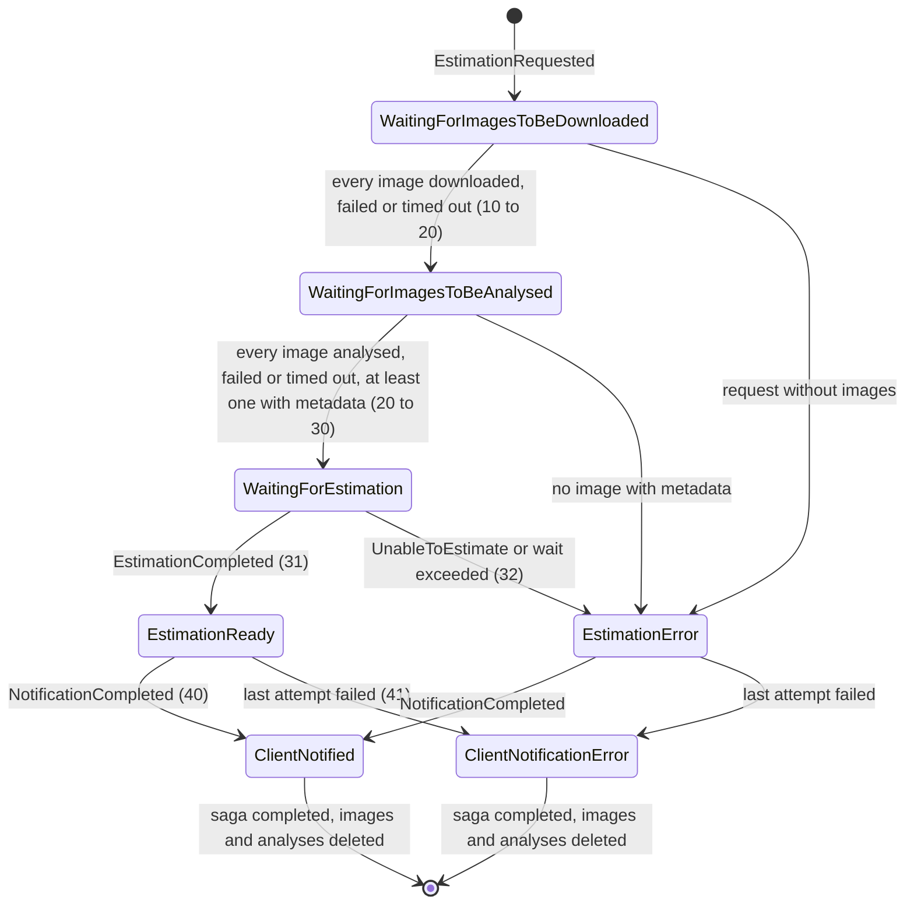
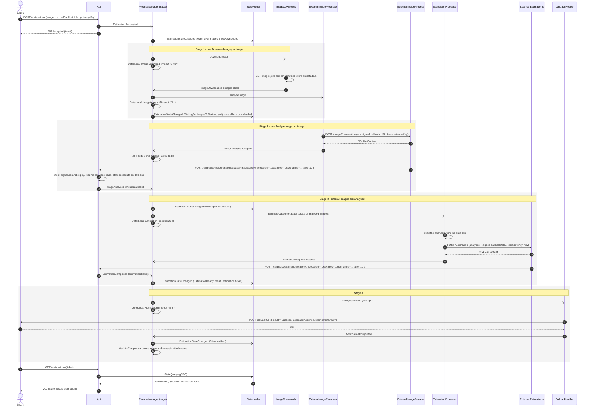
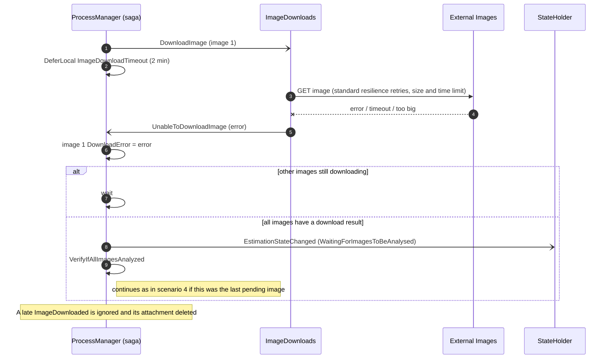
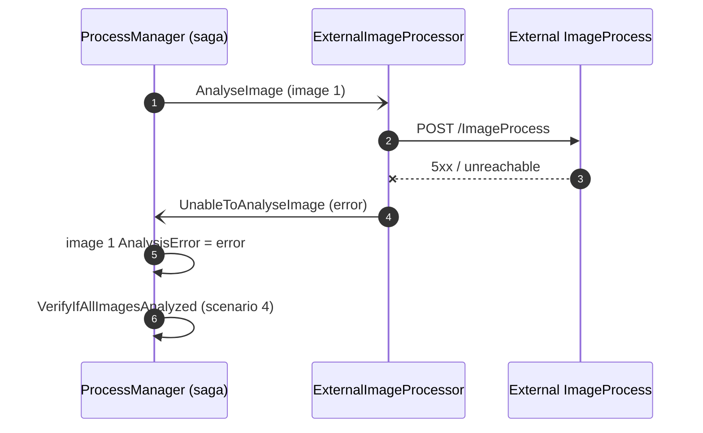
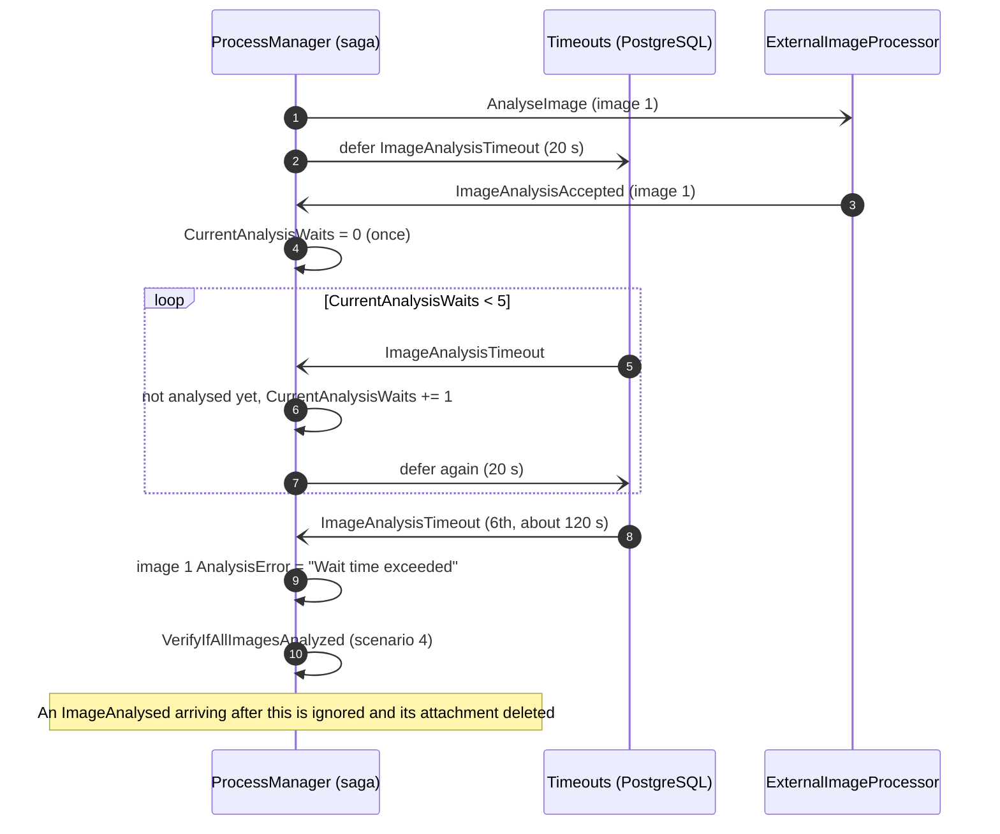
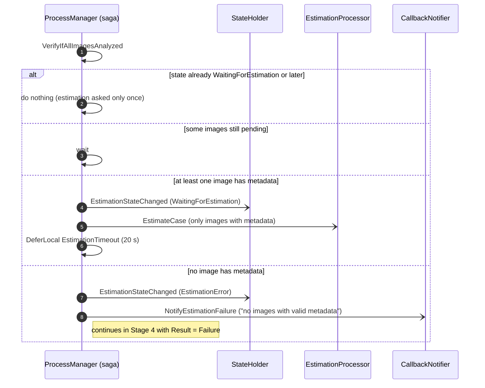
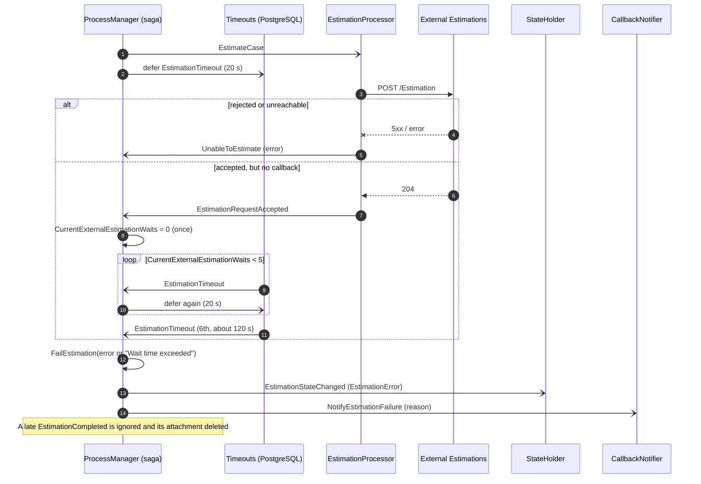
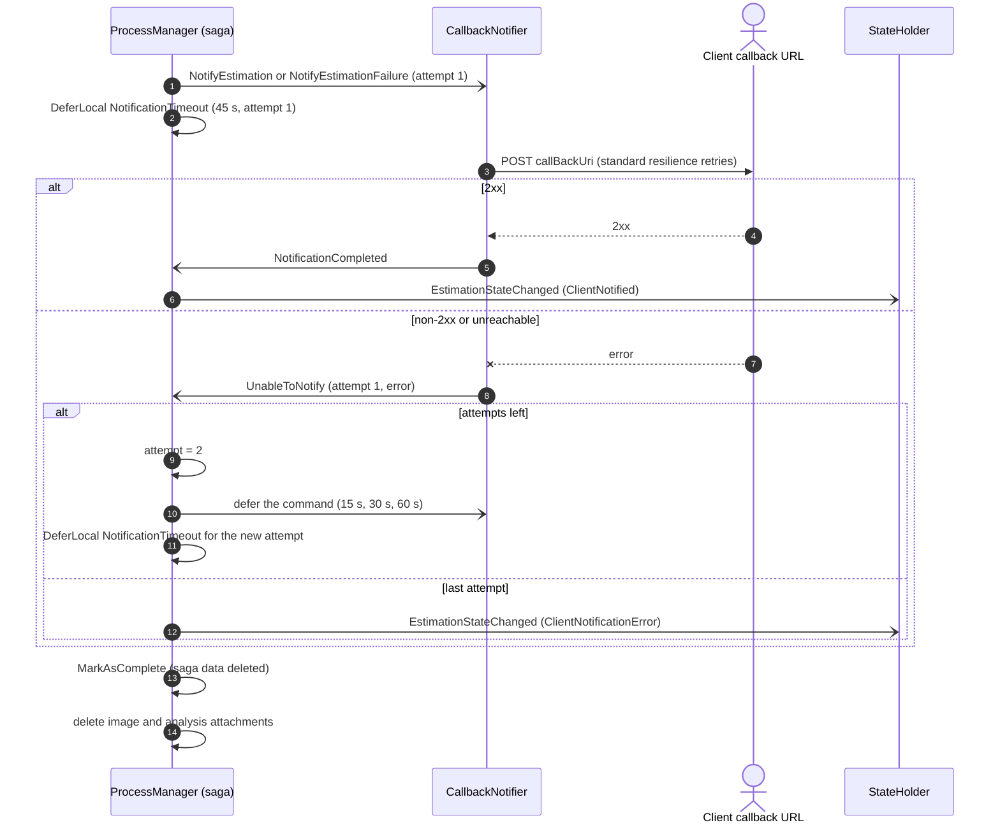
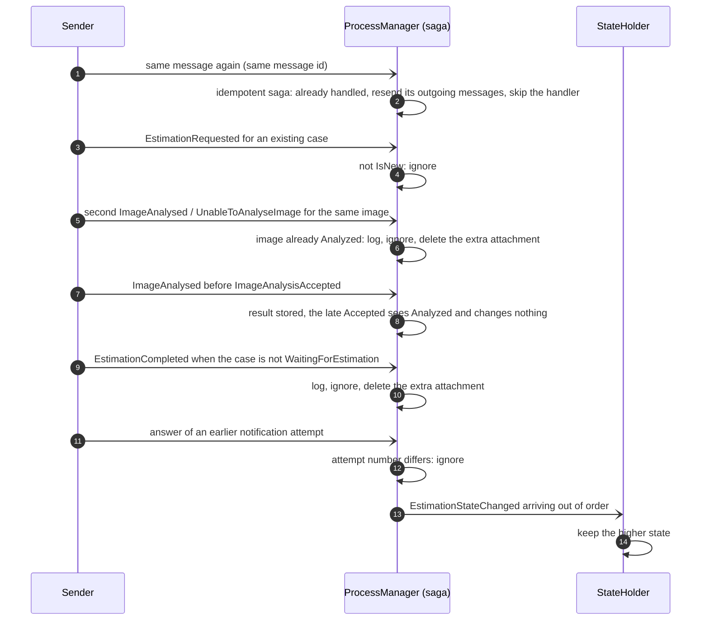
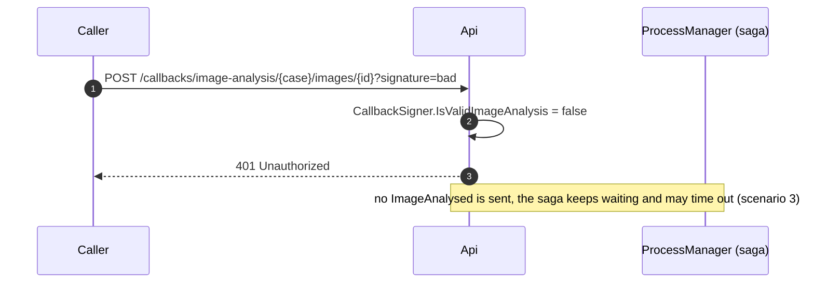

# Estimations — Messages flow

How a case moves through the system: the messages, the case states, the happy path and every failure the design handles on its own. [system.md](system.md) has the services, the timeouts and the business decisions behind them.

Every message carries the `CaseNumber` (the ticket), which ties it to its saga. Commands and the workers' replies go to one queue. The case's own events (`EstimationStateChanged`, `CaseCompleted`, `CaseFailed`) are published to every queue that subscribed to them.

## Messages

Rows follow the order of the flow.

| Stage | Message | From → to | Meaning |
| --- | --- | --- | --- |
| Start | `EstimationRequested` | Api → ProcessManager | Starts a new saga with the client id, callback URL and image URLs. |
| Any | `EstimationStateChanged` | ProcessManager → subscribers (StateHolder) | The case moved to a new state. Carries the result, failure reason, estimation ticket and skipped images known so far. |
| 1 Download | `DownloadImage` | ProcessManager → ImageDownloads | Command: download image *n*. One per image. |
| 1 Download | `ImageDownloaded` | ImageDownloads → ProcessManager | Image stored; carries its data bus ticket. |
| 1 Download | `UnableToDownloadImage` | ImageDownloads → ProcessManager | Download failed after the HTTP retries, was too big or too slow. |
| 1 Download | `ImageDownloadTimeout` | ProcessManager → itself (deferred 2 min) | The download never answered. |
| 2 Analyse | `AnalyseImage` | ProcessManager → ExternalImageProcessor | Command: send image *n* to the external image service. |
| 2 Analyse | `ImageAnalysisAccepted` | ExternalImageProcessor → ProcessManager | The external service accepted the image; it gets a fresh wait. |
| 2 Analyse | `UnableToAnalyseImage` | ExternalImageProcessor → ProcessManager | The external service rejected the image or could not be reached. |
| 2 Analyse | `ImageAnalysisTimeout` | ProcessManager → itself (deferred 20 s) | Timeout tick while waiting for the analysis. |
| 2 Analyse | `ImageAnalysed` | Api (callback) → ProcessManager | The analysis arrived; carries the metadata ticket. |
| 3 Estimate | `EstimateCase` | ProcessManager → EstimationProcessor | Command: ask for the estimation with the analysed images' metadata tickets. |
| 3 Estimate | `EstimationRequestAccepted` | EstimationProcessor → ProcessManager | The external service accepted the request; it gets a fresh wait. |
| 3 Estimate | `UnableToEstimate` | EstimationProcessor → ProcessManager | The external service rejected the request or could not be reached. |
| 3 Estimate | `EstimationTimeout` | ProcessManager → itself (deferred 20 s) | Timeout tick while waiting for the estimation. |
| 3 Estimate | `EstimationCompleted` | Api (callback) → ProcessManager | The estimation arrived; carries the estimation ticket. |
| 4 Notify | `NotifyEstimation` | ProcessManager → CallbackNotifier | Command: post the estimation to the client. Carries the `Attempt` and the skipped images. |
| 4 Notify | `NotifyEstimationFailure` | ProcessManager → CallbackNotifier | Command: post the failure reason to the client. |
| 4 Notify | `NotificationCompleted` | CallbackNotifier → ProcessManager | The client accepted the notification (2xx). |
| 4 Notify | `UnableToNotify` | CallbackNotifier → ProcessManager | The client callback failed after the HTTP retries; carries the `Attempt` and the error. |
| 4 Notify | `NotificationTimeout` | ProcessManager → itself (deferred) | The notifier never answered this attempt. |
| End | `CaseCompleted` | ProcessManager → subscribers | Published once when a case with an estimation ends. Carries the estimation ticket, the skipped images, whether the client was notified, and when the case started and finished. |
| End | `CaseFailed` | ProcessManager → subscribers | Published once when a case without an estimation ends. Carries the failure reason (`no_valid_images`, `estimation_rejected`, `estimation_timeout`), the error text, the skipped images, whether the client was notified, and when the case started and finished. |

The saga's own `…Timeout` messages live in the ProcessManager project; they are not part of the shared contract.

## Case states

A case moves through seven states (`EstimationStates`), always forward; the number is the enum value, and StateHolder keeps the highest one it has seen. `GET /estimations/{ticket}` returns the state name and, once the case has a result, `result` (`Success` or `Failure`); a ticket the client doesn't own answers `404`.

`ClientNotified` after `EstimationError` means the client was told about the failure, not that the case succeeded: read `result`. The estimation itself stays on the data bus (24 hours by default) so the client can still read it from the `GET` after a notification failed.

## Happy path

With every external call succeeding, a case with two images takes about 25 s: the external image and estimation services each answer after 10 s, and the client callback takes 2 s. Every wait and limit is listed in [system.md](system.md#timeouts-and-limits). The diagram shows one image; the download and analysis steps run once per image, in parallel.

Arrows with an open head are asynchronous Rebus messages; arrows with a filled head are HTTP or gRPC calls; dashed arrows are responses. The pending `…Timeout` messages still fire later, see that the result is already there, and do nothing.

## Failure scenarios

A failure on one image never stops the case: the image is marked as failed, listed in `skippedImages`, and the case continues with the rest. The case fails only when no image can be analysed, or when the estimation or its wait fails. The client is notified either way.

These are failures of the business flow. To cause them on purpose, see [runtime-faults.md](runtime-faults.md) and the guided cases in [chaos-scenarios.md](chaos-scenarios.md).

### 1. An image can't be downloaded

The HTTP client retries first. A download also stops when the image is larger than `Downloads:MaxBytes` (20 MB) or takes longer than `Downloads:Timeout` (60 s), and a URL that isn't absolute http or https is rejected. If it still fails, the image counts as both downloaded and analysed (with an error) and is never sent for analysis. If even the worker's answer never arrives, `ImageDownloadTimeout` (2 min) does the same.

### 2. The external image service rejects an image

A non-2xx response, a connection error or a missing attachment ends the image's analysis with an error straight away.

### 3. The image analysis never arrives (timeout)

The wait starts when the saga sends `AnalyseImage`, so it also covers a worker that never answers. When the external service accepts the image, `ImageAnalysisAccepted` starts the counter again, so the service always gets the full wait. The saga checks every 20 s; after the first wait plus 5 more (about 120 s) it gives up on that image.

### 4. Deciding whether the case can be estimated

Once every image has a result (analysed, download error, analysis error or timeout), the saga either asks for the estimation with the images that have metadata, or fails the case.

### 5. The estimation fails or never arrives

The estimation has the same wait as an image analysis (started with `EstimateCase`, restarted by `EstimationRequestAccepted`), but any failure fails the whole case. A missing analysis attachment is reported as `UnableToEstimate` too.

### 6. Notifying the client

The notifier posts `Result = Success` with the estimation, or `Result = Failure` with the reason, plus the `skippedImages`. Each try has an `Attempt` number. The notifier's HTTP client retries first; if the call still fails (or the notifier doesn't answer within 45 s) the saga sends the command again after 15 s, then 30 s, then 60 s, up to 4 attempts. Only then the case ends as `ClientNotificationError`. Either way the saga ends and deletes the case's images and analyses; the estimation stays for the retention time.

The client can receive the same notification more than once (an HTTP retry, a saga retry after a slow answer). Every request carries the same `Idempotency-Key` (the case number), and a signature the client can check.

### 7. Duplicate, late and out-of-order messages

RabbitMQ delivers at least once and the external services may call back twice or after the saga stopped waiting. Each case is handled without repeating a step, and an attachment stored for a message the saga ignores is deleted.

Messages for a saga that already finished find no saga data and are dropped by Rebus. Their attachments, and any other attachment older than `DataBus:Retention` (24 hours), are deleted by the ProcessManager's data bus sweeper.

### 8. A callback with a bad signature or an old URL

The callback URLs given to the external services carry an HMAC signature tied to the case (and image), to the expiry time (`expires`, 30 minutes after the URL was built) and to the trace context in the URL. A call with a missing or wrong signature, one reused for another case or image, one whose `traceparent` or `expires` was changed, or one used after it expired, is rejected before any message is sent or attachment stored.

### 9. A request that is sent twice

`POST /estimations` accepts an `Idempotency-Key` header. The case number is derived from the client and the key, so a repeated request names the same case: the Api answers `202` with the same ticket, and sends no second `EstimationRequested` when the StateHolder already knows the case (a second copy racing past that check is ignored by the saga, see scenario 7). The body of the repeated request is not compared with the first one. Without the header every request starts a new case.
