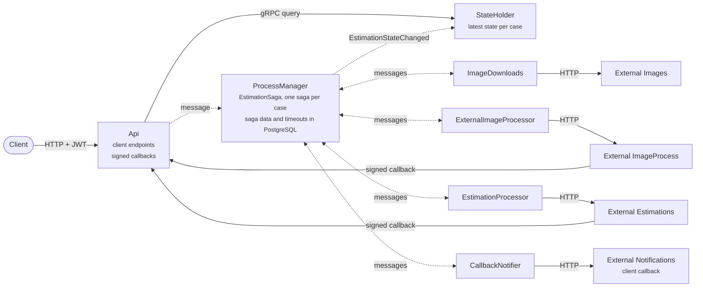
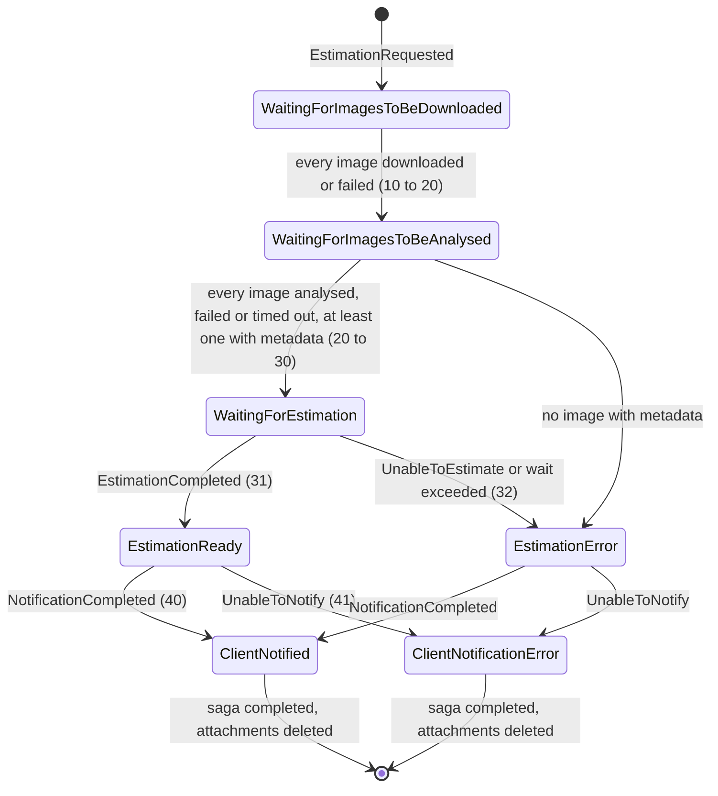
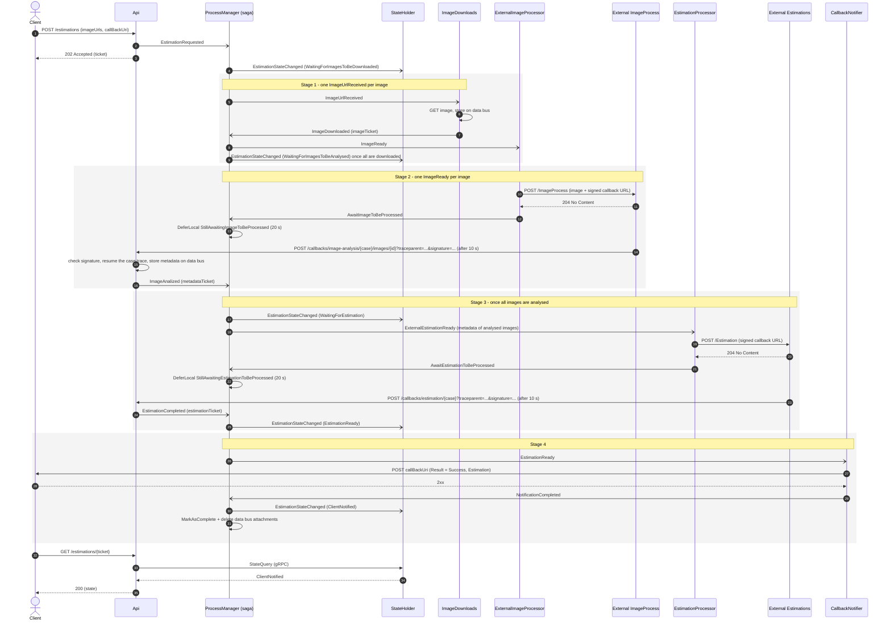
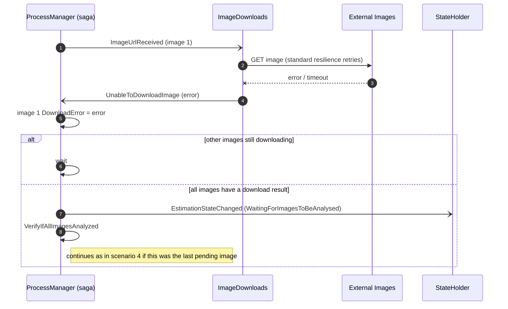
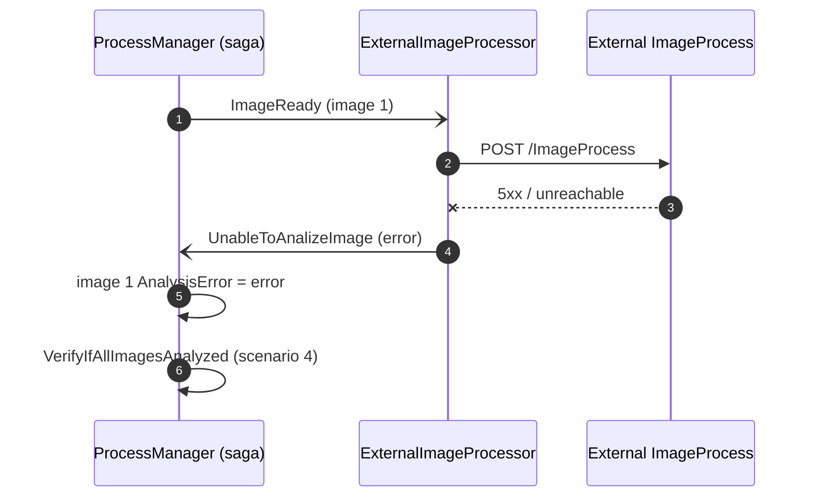
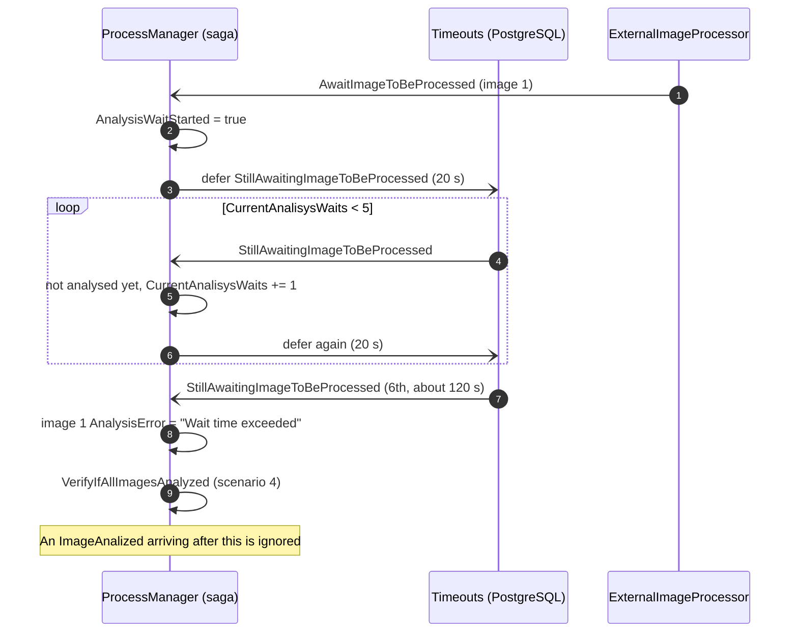
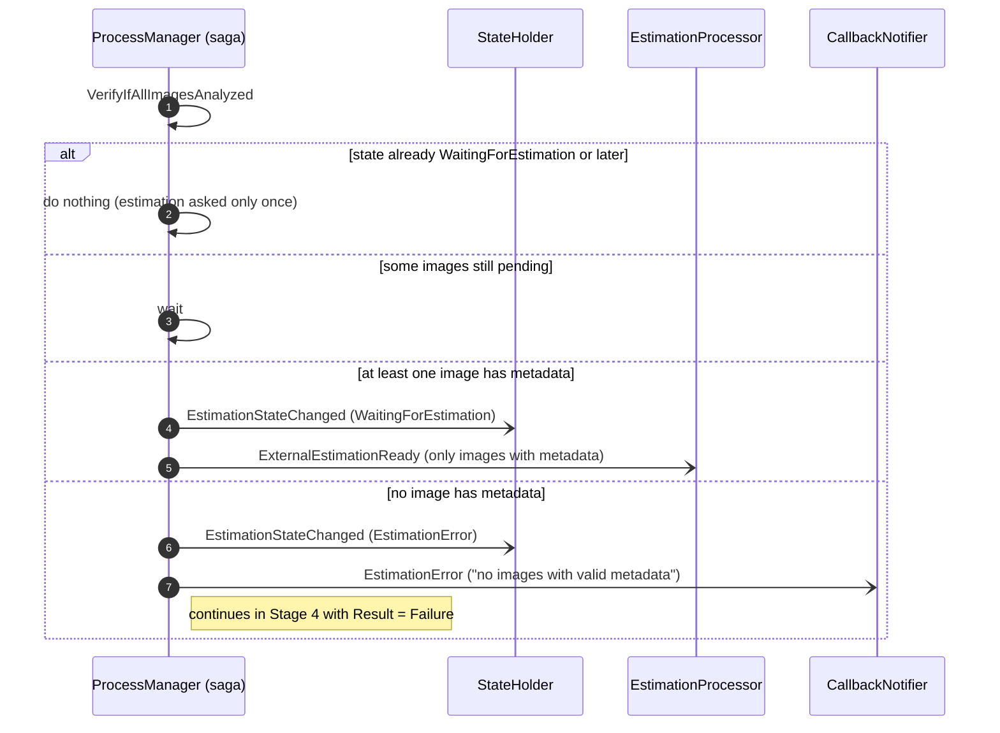
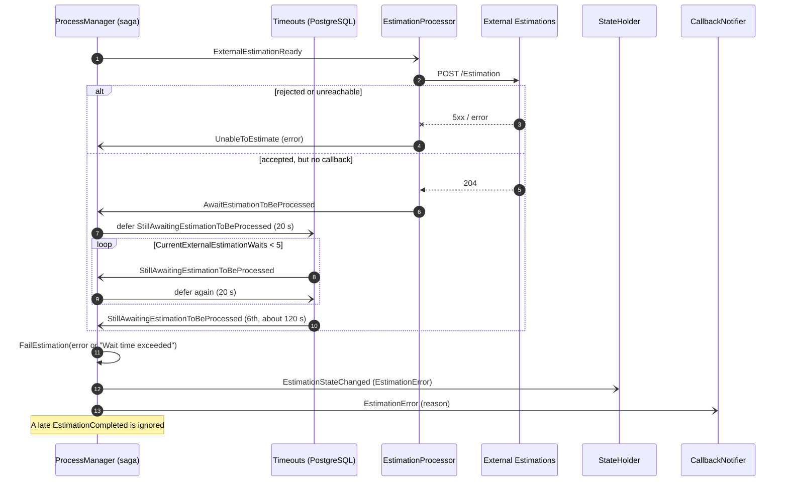
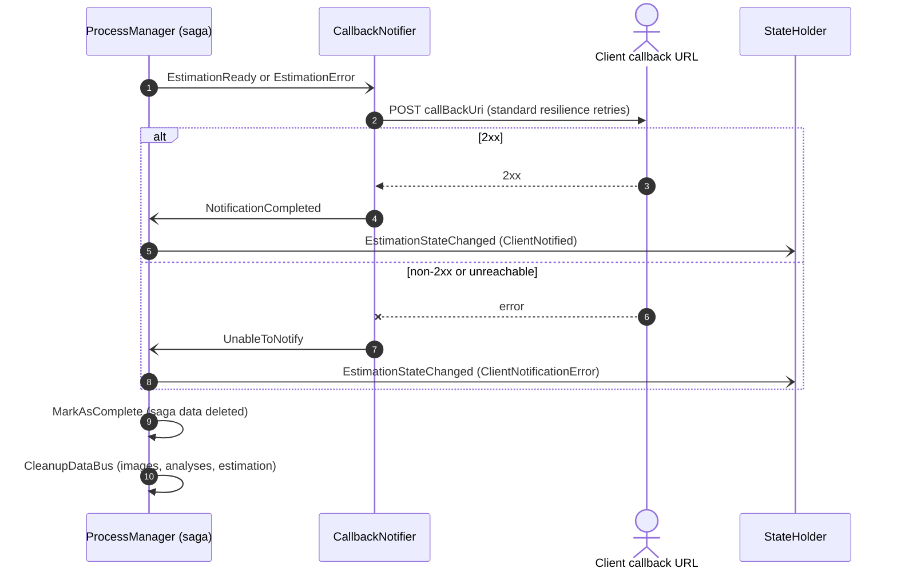

# Estimations — Messages Flow

How a case moves through the system, which messages each step sends, and what happens when something fails.

## Overview

A client posts a list of image URLs and a callback URL; the system downloads each image, has an external service analyse it, asks another external service for one estimation built from the analyses, and posts the result to the client's callback URL. The client gets a ticket straight away and can poll its state at any time.

The work runs as four stages, all driven by one process manager (the `EstimationSaga`, one saga per case):

1. **Download** every image (one message per image, in parallel).
2. **Analyse** every downloaded image with the external image service, which answers later through a signed callback.
3. **Estimate** the case with the external estimation service, which also answers through a signed callback.
4. **Notify** the client with the estimation or the error.

Services never call each other directly except over HTTP at the edges (external systems, client callback) and gRPC for the state query. Everything inside travels as Rebus messages over RabbitMQ. Images, analyses and estimations are stored as data bus attachments in the shared `.data/databus` folder; messages only carry their ticket (the attachment id).



Dotted arrows are RabbitMQ messages; solid arrows are HTTP or gRPC calls. The ProcessManager sends work to one worker per external system and gets a result message back; the external image and estimation services answer later through signed callbacks on the Api, which turns them into messages for the saga.

## Components

Seven application services share RabbitMQ and the data bus folder; four fake external systems stand in for the outside world. Two Aspire AppHosts start them: [src/Aspire/Acheve.AppHost](../src/Aspire/Acheve.AppHost/AppHost.cs) runs the application and its infrastructure, and [src/Aspire/Acheve.External.AppHost](../src/Aspire/Acheve.External.AppHost/AppHost.cs) runs the fakes on fixed ports (https://localhost:5001-5004). The application only knows the fakes' URLs, from the `ExternalSystems` settings of its AppHost.

Like real external systems, the fakes don't take part in the application's traces: they ignore incoming trace headers and send none in their callbacks. Each case's trace continues across a callback through the `traceparent` the application puts in the callback URL, and the fakes' own requests show up as separate traces.

| Service | Input queue | Role |
| --- | --- | --- |
| Api | none (one-way client) | Client entry point: `POST /estimations` starts a case, `GET /estimations/{ticket}` returns its state. Also receives the signed callbacks from the external image and estimation services and turns them into messages. |
| ProcessManager | `processmanager` | Runs `EstimationSaga`. Holds the case data in PostgreSQL (`saga_data`) and its deferred timeout messages (`timeouts`). The only service that decides what happens next. |
| ImageDownloads | `imagedownloads` | Downloads one image from its URL and stores it on the data bus. |
| ExternalImageProcessor | `imageprocess` | Sends one image to the external image service with a signed callback URL. |
| EstimationProcessor | `externalestimations` | Sends the analyses to the external estimation service with a signed callback URL. |
| CallbackNotifier | `callbacknotifications` | Posts the final result (success or failure) to the client's callback URL. |
| StateHolder | `stateholder` | Keeps the latest state of every case in memory; the Api queries it over gRPC. |
| External.Images | — | Serves the sample images over HTTP. |
| External.ImageProcess | — | Accepts an image, waits 10 s, posts the metadata to the callback URL. Runs up to 20 jobs at a time. |
| External.Estimations | — | Accepts the analyses, waits 10 s, posts the estimation to the callback URL. Runs up to 20 jobs at a time. |
| External.Notifications | — | Plays the client: receives the final notification. |

## Messages

Every message carries the `CaseNumber` (the ticket), which correlates it to its saga. Messages are sent to one queue (type-based routing), never published. Rows follow the order of the flow.

| Stage | Message | From → to | Meaning |
| --- | --- | --- | --- |
| Start | `EstimationRequested` | Api → ProcessManager | Starts a new saga with the client id, callback URL and image URLs. |
| Any | `EstimationStateChanged` | ProcessManager → StateHolder | The case moved to a new state. |
| 1 Download | `ImageUrlReceived` | ProcessManager → ImageDownloads | Download image *n*. One per image. |
| 1 Download | `ImageDownloaded` | ImageDownloads → ProcessManager | Image stored; carries its data bus ticket. |
| 1 Download | `UnableToDownloadImage` | ImageDownloads → ProcessManager | Download failed after the HTTP retries. |
| 2 Analyse | `ImageReady` | ProcessManager → ExternalImageProcessor | Send image *n* to the external image service. |
| 2 Analyse | `AwaitImageToBeProcessed` | ExternalImageProcessor → ProcessManager | The external service accepted the image; start waiting. |
| 2 Analyse | `UnableToAnalizeImage` | ExternalImageProcessor → ProcessManager | The external service rejected the image or could not be reached. |
| 2 Analyse | `StillAwaitingImageToBeProcessed` | ProcessManager → itself (deferred 20 s) | Timeout tick while waiting for the analysis. |
| 2 Analyse | `ImageAnalized` | Api (callback) → ProcessManager | The analysis arrived; carries the metadata ticket. |
| 3 Estimate | `ExternalEstimationReady` | ProcessManager → EstimationProcessor | Ask for the estimation with the analysed images' metadata. |
| 3 Estimate | `AwaitEstimationToBeProcessed` | EstimationProcessor → ProcessManager | The external service accepted the request; start waiting. |
| 3 Estimate | `UnableToEstimate` | EstimationProcessor → ProcessManager | The external service rejected the request or could not be reached. |
| 3 Estimate | `StillAwaitingEstimationToBeProcessed` | ProcessManager → itself (deferred 20 s) | Timeout tick while waiting for the estimation. |
| 3 Estimate | `EstimationCompleted` | Api (callback) → ProcessManager | The estimation arrived; carries the estimation ticket. |
| 4 Notify | `EstimationReady` | ProcessManager → CallbackNotifier | Post the estimation to the client. |
| 4 Notify | `EstimationError` | ProcessManager → CallbackNotifier | Post the failure reason to the client. |
| 4 Notify | `NotificationCompleted` | CallbackNotifier → ProcessManager | The client accepted the notification (2xx). |
| 4 Notify | `UnableToNotify` | CallbackNotifier → ProcessManager | The client callback failed after the HTTP retries. |

## Case states

A case moves through seven states (`EstimationStates`), always forward; the number is the enum value, and StateHolder keeps the highest one it has seen. `GET /estimations/{ticket}` returns the state name, or `Unknown ticket`.



`ClientNotified` after `EstimationError` means the client was told about the failure, not that the case succeeded.

## Happy path

With every external call succeeding, a case with two images takes about 25 s: the external image and estimation services each answer after 10 s, and the client callback takes 2 s. The diagram shows one image; the download and analysis steps run once per image, in parallel.

The two fakes run their accepted jobs in the background, up to `BackgroundQueue:MaxConcurrency` at a time (20 by default), so each handles about 120 jobs a minute before jobs start to wait. Up to `BackgroundQueue:Capacity` jobs (100 by default) can wait; past that a new request blocks until there is room.



Arrows with an open head are asynchronous Rebus messages; arrows with a filled head are HTTP or gRPC calls; dashed arrows are responses. The pending `StillAwaiting…` timeouts still fire later, see that the result is already there, and do nothing.

## Failure scenarios

A failure on one image never stops the case: the image is marked as failed and the case continues with the rest. The case fails only when no image can be analysed, or when the estimation or its wait fails.

To make any of these happen on demand, switch a [chaos scenario](chaos.md) on an external system or on the Api's callbacks.

### 1. An image can't be downloaded

The HTTP client retries first. If it still fails, the image counts as both downloaded and analysed (with an error) and is never sent for analysis.



### 2. The external image service rejects an image

A non-2xx response, a connection error or a missing attachment ends the image's analysis with an error straight away; no timeout is started.



### 3. The image analysis never arrives (timeout)

The external service accepted the image but never calls back. The saga checks every 20 s; after the first wait plus 5 more (about 120 s) it gives up on that image.



### 4. Deciding whether the case can be estimated

Once every image has a result (analysed, download error, analysis error or timeout), the saga either asks for the estimation with the images that have metadata, or fails the case.



### 5. The estimation fails or never arrives

The estimation has the same two failure paths as an image analysis, but either one fails the whole case.



### 6. Notifying the client

The notifier posts `Result = Success` with the estimation, or `Result = Failure` with the reason. Either way the saga ends and deletes the case's attachments; only the final state differs.



### 7. Duplicate, late and out-of-order messages

RabbitMQ delivers at least once and the external services may call back twice or after the saga stopped waiting. Each case is handled without repeating a step.

```mermaid
sequenceDiagram
    autonumber
    participant X as Sender
    participant PM as ProcessManager (saga)
    participant SH as StateHolder

    X-)PM: same message again (same message id)
    PM->>PM: idempotent saga: already handled, resend its outgoing messages, skip the handler

    X-)PM: EstimationRequested for an existing case
    PM->>PM: not IsNew: ignore

    X-)PM: second ImageAnalized / UnableToAnalizeImage for the same image
    PM->>PM: image already Analyzed: log and ignore

    X-)PM: ImageAnalized before AwaitImageToBeProcessed
    PM->>PM: result stored; the late Await sees Analyzed and starts no timeout

    X-)PM: EstimationCompleted after the wait timed out
    PM->>PM: EstimationFinished: log and ignore

    PM-)SH: EstimationStateChanged arriving out of order
    SH->>SH: keep the higher state
```

Messages for a saga that already finished find no saga data and are dropped by Rebus.

### 8. A callback with a bad signature

The callback URLs given to the external services carry an HMAC signature tied to the case (and image) and to the trace context in the URL. A call with a missing or wrong signature, one reused for another case or image, or one whose `traceparent` was changed, is rejected before any message is sent.

```mermaid
sequenceDiagram
    autonumber
    participant Caller
    participant Api
    participant PM as ProcessManager (saga)

    Caller->>Api: POST /callbacks/image-analysis/{case}/images/{id}?signature=bad
    Api->>Api: CallbackSigner.IsValidImageAnalysis = false
    Api-->>Caller: 401 Unauthorized
    Note over Api,PM: no ImageAnalized is sent; the saga keeps waiting and may time out (scenario 3)
```

## Tracing

Each case can be followed as one distributed trace in the Aspire dashboard. `POST /estimations` returns the trace id as `OperationId`.

- Inside the system the trace travels on its own: HTTP and gRPC calls send the `traceparent` header, and Rebus copies it into every message, including deferred timeouts.
- The external image and estimation services don't send our trace context back, so it travels in the callback URL instead. `ImageReadyHandler` and `ExternalEstimationReadyHandler` add the current `traceparent` as a query parameter, and `CallbackSigner` includes it in the signature, so nobody can attach a callback to someone else's trace.
- When a callback arrives, the Api checks the signature and then starts an `image analysis callback` or `estimation callback` span (`CallbackTracing`) whose parent is the span that sent the request. The message it sends (`ImageAnalized` or `EstimationCompleted`) continues the case's trace.
- ASP.NET Core creates the callback's HTTP request span before our code runs, so that span stays in its own trace. The callback span links to it, and the dashboard shows the link.
- Callback spans are tagged with `estimation.case_number` (and `estimation.image_id` for an image).

A case's trace lasts as long as the case: about 25 s on the happy path and a few minutes when it waits for timeouts. If a production collector uses tail sampling, its decision wait must be longer than a case, or late spans end up in separate traces.

## Reliability rules

The saga is written so that any message can arrive twice, late or out of order without repeating a step.

| Mechanism | Where | What it guarantees |
| --- | --- | --- |
| Idempotent saga | `EnableIdempotentSagas()` in ProcessManager; `IdempotencyData` in `EstimationState` | The ids of handled messages and the messages each one sent are saved with the saga data. A redelivered message is skipped and its outgoing messages are resent, so a crash between saving the saga and sending never loses or repeats work. |
| Exclusive access | `EnforceExclusiveAccess()` | Two messages for the same case never run at the same time in one process. |
| Result guards | `Downloaded`, `Analyzed`, `EstimationFinished` checks in every handler | A second result for the same image or estimation (duplicate callback, result after a timeout) is logged and ignored. |
| Start guard | `IsNew` check in `Handle(EstimationRequested)` | A redelivered request never restarts a running case. |
| Move-on-once guard | `State >= WaitingForEstimation` in `VerifyIfAllImagesAnalyzed` | The estimation is requested only once per case. |
| Unknown image guard | `FindImage` returns null | A message naming an image the case doesn't have is dropped instead of failing on every retry. |
| Forward-only states | `State.AddOrUpdateState` in StateHolder | A state lower than the current one is ignored, so out-of-order `EstimationStateChanged` messages can't move a case backwards. |
| Timeouts | `DeferLocal` + PostgreSQL `timeouts` table | Each wait (per image, and for the estimation) re-checks every 20 s up to 5 extra times, then gives up after about 2 minutes. |
| Signed callbacks | `CallbackSigner` (HMAC-SHA256 over `image-analysis:{case}:{image}` or `estimation:{case}`, plus the `traceparent` in the URL) | Only a caller holding the URL we generated can report a result for that case and image; anything else gets `401` and no message is sent. The key is generated by Aspire and kept in user secrets so callbacks for running cases survive a restart. |
| HTTP retries | `AddStandardResilienceHandler()` on every outgoing HTTP client; gRPC retry policy (4 attempts, 30 s deadline) on the state query | Transient HTTP failures are retried before a worker reports an `UnableTo…` message. |
| Data bus cleanup | `CleanupDataBus()` at the end of the saga | Every image, analysis and estimation attachment for the case is deleted once the client was notified (or notification failed). |
