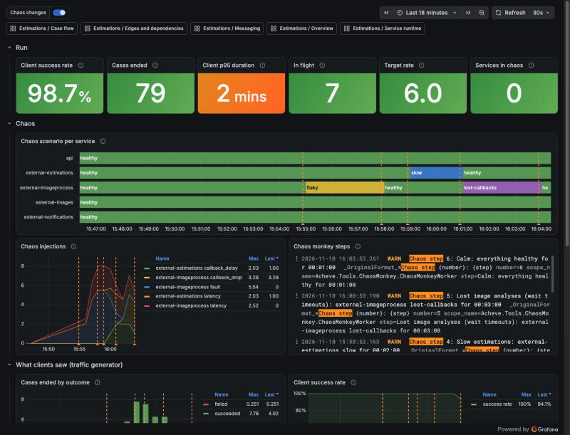

# Runtime faults: chaos, resilience and consumption

Three switches change how the running system behaves, without a restart:

| Switch | Question it answers | Where it acts |
| --- | --- | --- |
| **Chaos** | What if a dependency misbehaves? | Injects faults into the fake external systems and the Api's callbacks |
| **Resilience** | How much do we tolerate? | Sets the HTTP resilience of the four services that call the external systems |
| **Consumption** | What if one of our workers stalls? | Stops a worker taking messages from its queue |

Chaos breaks things; resilience decides how hard the callers fight back; consumption breaks *us* instead of *them*. Set them side by side and you can see what each tolerance setting buys, what it costs, and what it can't see at all. The **chaos monkey** automates the three together as short scripted stories, explained in [chaos-scenarios.md](chaos-scenarios.md).

All three only work in Development. Run the [traffic generator](traffic.md) while you use them: without load there is nothing to see.

## Chaos

Every fake external system, and the Api's `/callbacks` endpoints, can fail requests, answer slowly, or (for the two systems that call back) lose, duplicate or delay their callbacks. Code: [Acheve.Common.Chaos](../src/Common/Acheve.Common.Chaos). Faults and latency use Polly's chaos strategies (Simmy) in a middleware; callback misbehaviour is planned by the fakes that call back.

| Scenario | What it injects | What to expect |
| --- | --- | --- |
| `healthy` | Nothing (the default). | |
| `flaky` | 30% of requests fail with 503; 20% wait 2 s first. | The callers' retries hide most of it: more calls and latency, few failed cases. |
| `slow` | Every request waits 5 s; callbacks come 20 s later. | Slower cases and more wait checks in the saga, but no failures with the `standard` profile. |
| `down` | Every request fails with 503. | Retries run out: failed images or estimations, failed client notifications. |
| `lost-callbacks` | Half of the accepted work never calls back. | The saga's wait (about 2 min) gives up on those images or estimations. |
| `duplicate-callbacks` | Half of the callbacks are sent twice. | The saga ignores the second one; cases complete normally. |

`lost-callbacks` and `duplicate-callbacks` only exist on `external-imageprocess` and `external-estimations`. On the Api, chaos only touches `/callbacks` (`Chaos:Paths`), so clients can still start cases and read them. Health checks and `/chaos` itself are never broken.

**Targets:** `api`, `external-images`, `external-imageprocess`, `external-estimations`, `external-notifications`.

**Switching it:**

- Aspire dashboard: a resource's **…** → **Commands** → **Chaos: \<scenario\>** (the fakes are in the external AppHost's dashboard).
- HTTP on each target: `GET /chaos`, `POST /chaos/scenarios/{name}`, or `PUT /chaos` with custom settings (scenario `custom`), for example `{"faultRate": 0.5, "faultStatusCode": 500}` or `{"callbackDropRate": 1}`. Rates go from 0 to 1.
- At start: `Chaos:Scenario` (for example `Chaos__Scenario=flaky`).

**Seeing it:** `chaos_injections_total` by `chaos_kind` (`fault`, `latency`, `callback_drop`, `callback_duplicate`, `callback_delay`) and `chaos_scenario`; `chaos_scenario_active` is 1 for the scenario in force. Request spans get a `chaos.injected` tag. A warning log when the scenario changes, and a line per injection.

## Resilience

The four services that call the external systems protect their HttpClient with Polly. The set of strategies is a **profile**, and the profile can be switched at run time. Code: [Acheve.Common.Resilience](../src/Common/Acheve.Common.Resilience). `AddSwitchableResilienceHandler()` replaces `AddStandardResilienceHandler()`; the pipeline is rebuilt when the profile changes (calls in flight finish on the old one) and kept otherwise, so the circuit breaker remembers its state.

| Profile | Strategies | Trade-off |
| --- | --- | --- |
| `standard` | Concurrency limit 1000, total timeout 30 s, 3 retries (exponential from 2 s, jitter), circuit breaker (10% failures over 100+ calls in 30 s, open 5 s), attempt timeout 10 s | The default, same as `AddStandardResilienceHandler()`. |
| `none` | Nothing | Every fault and slow answer reaches the handler, which reports failure at once. |
| `retry-only` | 3 retries (exponential from 2 s, jitter) | Hides flaky faults. Against an outage every call becomes four, and nothing limits how long a call takes. |
| `fail-fast` | Total timeout 5 s, circuit breaker (50% over 5+ calls in 30 s, open 30 s), attempt timeout 3 s | No retries. A system that is down is left alone quickly; a slow one is treated as failed. |
| `hedging` | Total timeout 30 s, up to 2 extra attempts, each sent when the previous one is 1 s late or fails, attempt timeout 10 s | The first good answer wins. Cuts the slow tail at the cost of extra calls. |

Retries and hedging send the same request more than once. That is safe because every POST carries an `Idempotency-Key` and the fakes don't do the work twice.

| Caller | Calls |
| --- | --- |
| `imagedownloads` | `external-images` |
| `imageprocessor` | `external-imageprocess` |
| `estimationprocessor` | `external-estimations` |
| `callbacknotifier` | `external-notifications` |

**Switching it:**

- Aspire dashboard: **Commands** → **Resilience: \<profile\>**.
- HTTP on each caller: `GET /resilience`, `POST /resilience/profiles/{name}`, or `PUT /resilience` with custom settings (profile `custom`; leave a strategy out to turn it off), for example `{ "concurrencyLimit": 2, "retry": { "maxRetryAttempts": 2, "baseDelay": "00:00:01" } }`. The other keys are `totalTimeout`, `attemptTimeout`, `hedging` (`maxHedgedAttempts`, `delay`) and `circuitBreaker` (`failureRatio`, `minimumThroughput`, `samplingDuration`, `breakDuration`). Retry and hedging can't be combined; settings Polly refuses get `400`.
- At start: `Resilience:Profile`.

**Seeing it:** `resilience_profile_active` is 1 for the profile in force. Polly counts every event in `resilience_polly_strategy_events_total` by `event_name` (`OnRetry`, `OnHedging`, `OnTimeout`, `OnCircuitOpened`, `OnCircuitClosed`, `OnRateLimiterRejected`…) and `pipeline_instance` (the profile). With `none` Polly reports nothing. A warning log when the profile changes.

HTTP resilience only sees our outgoing calls. A callback that never comes is invisible to it: only the saga's waits catch that ([system.md](system.md#the-sagas-waits)).

## Consumption

A worker can stop **consuming**: it takes no more messages from its queue while the process and its health checks stay up. Its queue grows and the cases waiting on it slow down; on resume it drains the backlog. This simulates a stalled consumer (a stuck dependency, a deadlock, a slow deploy) rather than a crash. Code: [Acheve.Common.Consumption](../src/Common/Acheve.Common.Consumption).

**Workers:** `imagedownloads`, `imageprocessor`, `estimationprocessor`, `callbacknotifier`, `processmanager`, `stateholder` (the Api only sends).

**Switching it:**

- Aspire dashboard: **Commands** → **Consumption: pause** or **Consumption: resume**.
- HTTP on each worker: `GET /consumption` (`running` or `paused`), `POST /consumption/pause`, `POST /consumption/resume`.

A pause sets Rebus's workers to 0 and waits for the messages being handled to finish. A pause sent while the worker is still starting is refused (`409`) and changes nothing: send it again a moment later.

**What to expect while paused:**

- **Messages waiting per queue** grows.
- **Messages being handled per queue** shows up to 5 for the paused worker: the messages RabbitMQ had already handed it (prefetch 5). They are handled on resume.
- **Queues without consumers** (Messaging dashboard) stays at 0: the worker is still connected. To light that panel up, stop the resource instead; that is a crash, and the health check goes red too.
- **Latency or failures?** It depends on how long the pause lasts against the saga's waits ([system.md](system.md#the-sagas-waits)): 2 min for a download, about 2 min for an analysis or an estimation, 45 s per notification attempt. The clock starts when the saga sends the command, so time in the paused queue counts. Pausing the `processmanager` also delays its own timeouts, so it only adds latency.

**Seeing it:** `consumption_paused` is 1 while paused, by `service_name`, and a warning log on pause and resume.

## Chaos monkey

[Acheve.Tools.ChaosMonkey](../src/Tools/Acheve.Tools.ChaosMonkey) runs **strategies**: scripted sequences of steps, each setting the chaos, resilience and consumption switches above for a while. The strategies we ship, what each shows and how to read it, are in [chaos-scenarios.md](chaos-scenarios.md).

It starts with the application's AppHost and waits. Start the traffic generator first, then a strategy:

- Aspire dashboard: `chaosmonkey`'s **Commands** → **Strategy: \<name\>**, **Strategy: next step** (end the current step now), **Strategy: stop**.
- HTTP: `GET /strategies` (names and the one running, with its step), `POST /strategies/{name}`, `POST /strategies/next`, `POST /strategies/stop`.

Only one strategy runs at a time. When it finishes, is stopped or replaced, or the monkey stops, every target goes back to `healthy`, every caller to `standard` and every worker to `running`.

**Defining a strategy.** In `ChaosMonkey:Strategies` of its [appsettings.json](../src/Tools/Acheve.Tools.ChaosMonkey/appsettings.json). A strategy has either `Steps` (in order, repeated when `Repeat` is on) or `Random`. A step sets `Chaos` (scenario per target), `Resilience` (profile per caller) and `Consumption` (`paused` or `running` per worker) for `Duration`; what it doesn't name goes back to the default:

```json
{
  "Name": "Images down, retries only (every call becomes four)",
  "Duration": "00:02:00",
  "Chaos": { "external-images": "down" },
  "Resilience": { "imagedownloads": "retry-only" }
}
```

The monkey refuses to start when a step names something that doesn't exist (for example `lost-callbacks` on the Api), or when a strategy has no dashboard command: a new one needs its name in `Constants.ChaosMonkey.Strategies` and a description in [ChaosMonkeyCommands.cs](../src/Aspire/Shared/ChaosMonkeyCommands.cs).

**Seeing it:** a log line per strategy start, stop and step; `chaos_monkey_switches_total` by `chaos_kind` (`chaos`, `resilience`, `consumption`), `chaos_target`, `chaos_value` and `chaos_result`; `chaos_monkey_steps_total` by `chaos_strategy`. A target it can't reach (for example when the external AppHost isn't running) is logged and counted as failed, and the step goes on. What each service is *really* in comes from the services themselves: `chaos_scenario_active`, `resilience_profile_active`, `consumption_paused`.

## The Chaos run dashboard

**Estimations / Chaos run** in Grafana puts it together: per service, the chaos scenario, the resilience profile and whether it is consuming, next to the queues; every switch and every monkey step marked on every chart; and beside them what clients saw (the traffic generator's outcomes, success rate, duration and load) and what the saga saw.



In this run the image analysis was `flaky` from 15:55 to 15:58: about a quarter of the calls failed, but retries hid it and every case succeeded. Then the estimations were `slow`, and then the image analysis lost callbacks: cases waited for the saga's timeouts, the p95 duration rose to about 2 minutes and some cases failed.
