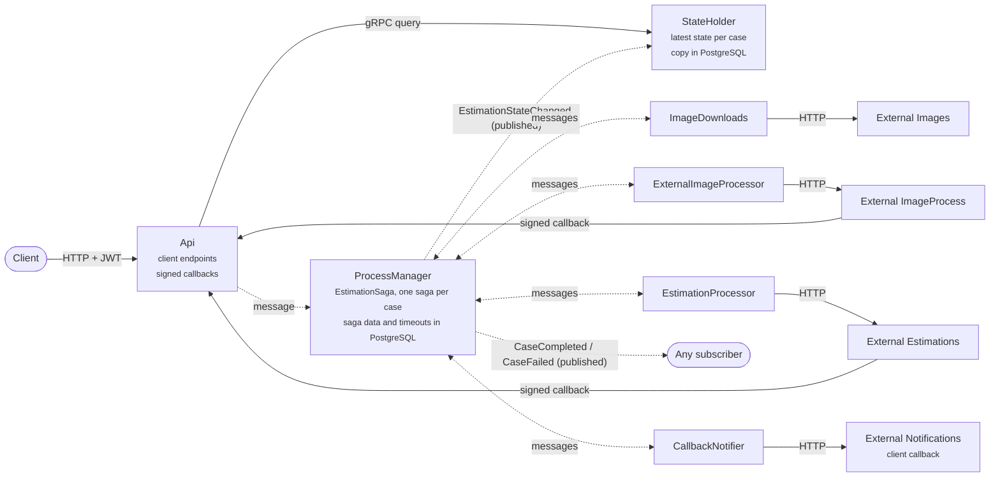

# Estimations — The system

What the system does, which service does what, how long each step may take, and the business decisions behind it. [messages-flow.md](messages-flow.md) follows a case message by message; [observability.md](observability.md) shows how to watch it.

## What it does

A client posts a list of image URLs and a callback URL. The system downloads each image, has an external service analyse it, asks another external service for one estimation built from the analyses, and posts the result to the client's callback URL. The client gets a ticket straight away and can ask for the case's state at any time.

The work runs in four stages, driven by one process manager (the `EstimationSaga`, one saga per case):

1. **Download** every image (one command per image, in parallel).
2. **Analyse** every downloaded image with the external image service, which answers later through a signed callback.
3. **Estimate** the case with the external estimation service, which also answers through a signed callback.
4. **Notify** the client with the estimation or the error.

With everything healthy, a case with two images takes about 25 s.

Dotted arrows are RabbitMQ messages (Rebus); solid arrows are HTTP or gRPC calls. Inside the system, services only talk through messages. Images, analyses and estimations are stored as data bus attachments in the shared `.data/databus` folder, and messages only carry their ticket.

## Services

Two Aspire AppHosts start everything. [Acheve.AppHost](../src/Aspire/Acheve.AppHost/AppHost.cs) runs the application and its infrastructure (RabbitMQ, PostgreSQL, the OpenTelemetry Collector, Grafana LGTM). [Acheve.External.AppHost](../src/Aspire/Acheve.External.AppHost/AppHost.cs) runs four fake external systems on https://localhost:5001-5004, so they behave like systems owned by someone else: the application only knows their URLs, and they don't join its traces.

| Service | Queue | Owns |
| --- | --- | --- |
| Api | none (only sends) | `POST /estimations` starts a case, `GET /estimations/{ticket}` returns its state. Receives the signed callbacks from the external image and estimation services and turns them into messages. |
| ProcessManager | `processmanager` | The `EstimationSaga`: the only service that decides what happens next. Keeps the case data (`saga_data`) and its deferred timeouts (`timeouts`) in PostgreSQL. Runs the data bus sweeper. |
| ImageDownloads | `imagedownloads` | Downloads one image and stores it on the data bus. |
| ExternalImageProcessor | `imageprocess` | Sends one image to the external image service with a signed callback URL. |
| EstimationProcessor | `externalestimations` | Sends the analyses to the external estimation service with a signed callback URL. |
| CallbackNotifier | `callbacknotifications` | Posts the final result to the client's callback URL, signed. |
| StateHolder | `stateholder` | The latest state of every case, for the Api's queries (gRPC). A copy lives in PostgreSQL and is loaded at startup. |
| External.Images | — | Serves the sample images. |
| External.ImageProcess | — | Accepts an image, waits 10 s, calls back with the metadata. |
| External.Estimations | — | Accepts the analyses, waits 10 s, calls back with the estimation. |
| External.Notifications | — | Plays the client: checks the signature and receives the notification (answers after 2 s). |

## Timeouts and limits

Every wait in the system, in one place. The other docs link here instead of repeating the numbers.

### The saga's waits

The saga starts each wait **in the same handler that sends the command**, so the clock includes the time the message waits in a queue and a command nobody answers still ends. The code is in [CaseImage.cs](../src/Application/Acheve.Application.ProcessManager/Handlers/CaseImage.cs) and [EstimationState.cs](../src/Application/Acheve.Application.ProcessManager/Handlers/EstimationState.cs).

| Step | Wait | When it runs out |
| --- | --- | --- |
| Download one image | 2 min (`ImageDownloadTimeout`) | The image counts as failed (`download_timeout`); the case goes on with the rest. Only fires when the worker never answers: its own limits (below) are shorter. |
| Analyse one image | A check every 20 s, 5 extra checks: about 2 min (`ImageAnalysisTimeout`) | The image counts as failed (`analysis_timeout`); the case goes on with the rest. |
| Estimate the case | A check every 20 s, 5 extra checks: about 2 min (`EstimationTimeout`) | The case fails (`estimation_timeout`); the client is told. |
| Notify the client, per attempt | 45 s (`NotificationTimeout`) | The attempt counts as failed and the next one is scheduled. |
| Notify the client, all attempts | 4 attempts: at once, then 15 s, 30 s and 60 s after each failure | The case ends as `ClientNotificationError`. |

When an external service accepts the work (`ImageAnalysisAccepted`, `EstimationRequestAccepted`), the check counter starts again once, so the service always gets the full wait from the moment it accepted.

The worst case, with every wait running out, lasts about 11 minutes. The **Stuck case** alert fires at 20 minutes and the traffic generator gives up at 15.

### The workers' limits

| Where | Limit | Setting |
| --- | --- | --- |
| ImageDownloads | An image larger than 20 MB, or slower than 60 s, fails; a URL that isn't absolute http or https is rejected | `Downloads:MaxBytes`, `Downloads:Timeout` |
| Every outgoing HTTP client | The `standard` resilience profile: 3 retries (exponential from 2 s), 10 s per attempt, 30 s in total, circuit breaker. Switchable at run time, see [runtime-faults.md](runtime-faults.md#resilience) | `Resilience:Profile` |
| Api → StateHolder (gRPC) | 4 attempts (backoff from 2 s), 30 s deadline | code |
| Every Rebus worker | Takes up to 5 messages at a time from RabbitMQ (prefetch) | `Constants.Queues.Prefetch` |
| Fake external systems | Each job takes 10 s; 20 jobs run at a time and 100 can wait, so each fake does about 120 jobs a minute | `BackgroundQueue:MaxConcurrency`, `BackgroundQueue:Capacity` |
| Fake external systems | Their callbacks use the standard resilience handler, so a flaky Api callback is retried | code |

### How long things are kept

| What | How long | Setting |
| --- | --- | --- |
| Callback URL given to an external service | Valid for 30 min | `CallbackSigner.DefaultValidity` |
| Client notification signature | The client should refuse one older than 5 min | `NotificationSigner.DefaultTolerance` |
| Images and analyses | Deleted when the case ends | — |
| The estimation | 24 h on the data bus, so the client can still read it | `DataBus:Retention` (sweep every `DataBus:SweepInterval`, 15 min) |
| A finished case in the StateHolder | 24 h | `State:Retention` (cleanup every 15 min). Keep it equal to `DataBus:Retention`. |
| An `Idempotency-Key` seen by a fake external system | 10 min | code |

## Business decisions

**The client never waits.** `POST /estimations` answers `202` with a ticket at once. The result arrives at the client's callback URL, and the client can also poll `GET /estimations/{ticket}`. A ticket the client doesn't own answers `404`.

**One bad image doesn't fail the case.** An image that can't be downloaded, is rejected or times out is skipped and listed in `skippedImages`. The case goes on with the others. It fails only when no image could be analysed (`no_valid_images`), or when the estimation is rejected (`estimation_rejected`) or never arrives (`estimation_timeout`).

**The saga owns every wait.** Workers don't time out the case; they report what happened (`ImageDownloaded`, `UnableTo…`). The saga decides when to stop waiting, so a crashed worker or a message stuck in the error queue can't leave a case open forever.

**The client is always told.** Success or failure, the client gets a notification, retried up to 4 times. `ClientNotified` means the client was told, not that the case succeeded: read `result` (`Success` or `Failure`).

**Doing a step twice must be harmless.** RabbitMQ delivers at least once, the fakes may call back twice or late, and HTTP retries resend requests. So:

- A repeated `POST /estimations` with the same `Idempotency-Key` returns the same ticket (the case number comes from the client and the key). Without the header every request is a new case.
- Every POST to an external system and to the client carries an `Idempotency-Key`, so retries and hedging are safe.
- The saga is idempotent: a redelivered message is skipped and its outgoing messages are resent.
- A second result for the same image or estimation, or one that arrives after the saga stopped waiting, is ignored and its attachment deleted.
- Notification attempts are numbered, so the answer of an old attempt can't trigger a new one.
- States only move forward: the StateHolder ignores an older state that arrives late.

**Only we can report a result.** The callback URLs are signed (HMAC) over the case, the image, the expiry and the trace context. A wrong, reused, changed or expired URL gets `401` and sends no message. The notifications to the client are signed too, so the client can check they come from us.

**The read side is separate.** The ProcessManager publishes `EstimationStateChanged`; the StateHolder keeps the latest state for the Api. The ProcessManager doesn't know who listens. It also publishes `CaseCompleted` and `CaseFailed` for future subscribers (none today). The AppHost starts the ProcessManager after the StateHolder, because an event published before the first subscription is lost.

## Known limits

- A repeated `Idempotency-Key` returns the first case even if the body is different; the body isn't compared.
- A case whose first `EstimationStateChanged` ended in the error queue answers `404` until the message is moved back.
- Renaming a message while messages are in flight breaks them: drain the queues and the `timeouts` table first.
- With several ProcessManager instances, two messages for one case can collide. Rebus retries the loser and the saga data uses optimistic concurrency.
