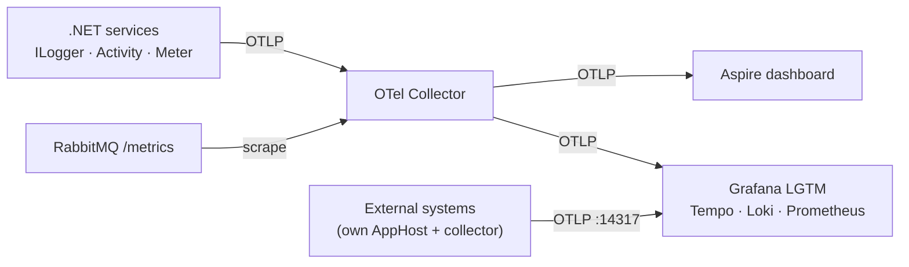

# Talk blueprint — "Do you know what your system is doing?"

Observability for developers, with .NET, OpenTelemetry, Aspire and Grafana, using the Estimations sample.

- **Audience:** developers who write and ship services. Not SREs.
- **Length:** about 60 minutes (45 talk + demos, 15 questions). Timings below are a guide.
- **One idea to take home:** observability is how you, the developer, ask your running system questions you didn't plan for, and get answers without shipping new code.

## The story that runs through the talk

Open with a support ticket: *"A client says their estimation never arrived. Ticket `3f2a…`."*

The system is a good villain for that story: one request becomes a saga with seven services, RabbitMQ, PostgreSQL, timeouts, retries and four external systems that answer through callbacks ([messages-flow.md](../messages-flow.md)). No single log file, no single stack trace, no debugger to attach. Every section of the talk gives you one more tool to answer the ticket, and the final demo closes it.

---

## 1. Why should a developer care? (5 min)

**Message:** you own the code in production, so you need to see what it does there. Monitoring tells you *that* something is wrong; observability helps you find out *why*, including for failures nobody predicted.

Key points:

- Distributed systems fail in partial, slow, weird ways: one external system is flaky, a callback never comes, a queue fills up.
- Logs alone answer "what did this process say?". They don't answer "what happened to this request across five processes?".
- The three signals and what each is good at:
  - **Metrics:** how much, how often, how fast. Cheap, aggregated, good for dashboards and alerts.
  - **Traces:** the path and timing of one request across services.
  - **Logs:** the detail of a single moment, with context.
- The value is in **connecting them**: from a metric spike, to the traces behind it, to the logs of one of them.

**Slide: the questions observability answers** (each mapped to this system, use it as a promise of what the talk will show):

| Question a developer asks | In Estimations | Signal |
| --- | --- | --- |
| Is the system healthy right now? | Cases started, success rate, cases running | Metrics |
| Where is this one request, and why is it stuck? | Follow a case number across the saga | Traces + logs |
| Where does the time go? | Time spent in each case state | Metrics (histogram) + traces |
| Is it us or them? | Failures and latency per external system | Traces (service graph) + metrics |
| Are messages flowing or piling up? | Queue depth, error queue | Metrics (RabbitMQ) |
| What changed when it broke? | Chaos scenario switches marked on every chart | Metrics + logs |
| What did the client actually see? | Traffic generator's view of each case | Metrics |

---

## 2. Instrumentation in .NET (8 min)

**Message:** .NET already has the instrumentation APIs built in. You don't depend on a vendor in your code; you use BCL types and plug OpenTelemetry in at startup.

| Signal | .NET API (in the BCL) | OpenTelemetry name |
| --- | --- | --- |
| Logs | `ILogger` (Microsoft.Extensions.Logging) | LogRecord |
| Traces | `ActivitySource` / `Activity` (System.Diagnostics) | Tracer / Span |
| Metrics | `Meter` / `IMeterFactory` (System.Diagnostics.Metrics) | Meter / Instrument |

Key points:

- ASP.NET Core, `HttpClient`, gRPC and the runtime already emit traces and metrics with these APIs. Libraries can too: Rebus does (`AddRebusInstrumentation`).
- Nothing is recorded unless someone listens: a `StartActivity` with no listener returns `null` (show the `activity?.` null-conditional calls).
- **Auto-instrumentation gets you 80%. The last 20% is your domain**, and only you can write it.

**Show:** [Extensions.cs:40-87](../../src/Aspire/Acheve.ServiceDefaults/Extensions.cs) — the whole setup for every service in ~40 lines:

- `builder.Logging.AddOpenTelemetry(...)` — logs.
- `.WithMetrics(...)` — ASP.NET Core, HttpClient, runtime, Rebus, plus our own meters by name (`AddMeter("Acheve.Estimations")`).
- `.WithTracing(...)` — our `ActivitySource` (named after the app), ASP.NET Core, HttpClient, Rebus.
- The filter that drops `/health` and `/alive` from traces (lines 75-79): a first "noise" best practice.
- `UseOtlpExporter()` only when `OTEL_EXPORTER_OTLP_ENDPOINT` is set (lines 89-100): the code doesn't know where telemetry goes.

**Talking point:** "If you forget `AddMeter("YourMeter")` or `AddSource("YourSource")`, your instrumentation silently records nothing." Point at the comments in [Constants.cs:31-59](../../src/Common/Acheve.Common.Shared/Constants.cs) that tie each meter name to its registration.

---

## 3. OpenTelemetry and OTLP (6 min)

**Message:** OpenTelemetry is the open standard for producing and shipping telemetry. Instrument once, send it anywhere.

Key points:

- **API vs SDK vs exporter.** In .NET the BCL plays the API role; the OpenTelemetry SDK collects, batches and exports.
- **OTLP** is the wire protocol (gRPC 4317, HTTP 4318). Every serious backend speaks it.
- **Resource attributes** describe *who* sent the data: `service.name`, `service.instance.id`, and here `service.namespace` to tell `application`, `external` and `tools` apart ([Extensions.cs:50-53](../../src/Aspire/Acheve.ServiceDefaults/Extensions.cs)).
- **Semantic conventions**: standard names (`http.request.method`, `http.response.status_code`, `peer.service`) so dashboards and tools work across languages and vendors. Prefix your own: `estimation.case_number`, `estimation.result`.
- **The Collector**: a pipeline between apps and backends — receive, process, export. Apps stay simple; routing, sampling and filtering live in one place.

**Show:** [otel-collector.yaml](../../src/Aspire/Acheve.AppHost/otel-collector.yaml)

- One OTLP receiver, two exporters: a copy to the Aspire dashboard, a copy to Grafana LGTM (lines 48-78).
- A second receiver that **scrapes** RabbitMQ's Prometheus endpoint (lines 15-30): telemetry from something you don't own, in the same backend.
- A `filter` processor that drops the .NET SDK's own `dotnet-cli` telemetry (lines 32-46): the collector is where you remove noise without touching the code.
- The point: changing backend is a config change, not a code change.

**Diagram for the slide:**

---

## 4. Aspire: observability from F5 (6 min)

**Message:** Aspire makes "telemetry on by default" the path of least resistance in local development.

Key points:

- **ServiceDefaults**: one project every service references; one `AddServiceDefaults()` call gives logs, traces, metrics, health checks and service discovery.
- **AppHost**: describes the system in C#. Aspire injects `OTEL_EXPORTER_OTLP_ENDPOINT`, `OTEL_SERVICE_NAME` and friends into each process, so the services need no telemetry config.
- **Dashboard**: an OTLP backend in memory. Structured logs, traces and metrics with zero setup. Great for the inner loop, not for production (no persistence).
- It isn't a lock-in: the same OTLP data goes to any backend.

**Show:** [AppHost.cs](../../src/Aspire/Acheve.AppHost/AppHost.cs)

- `AddContainer("lgtm", "grafana/otel-lgtm", ...)` — a full observability stack in one container, with dashboards and alerts mounted from the repo (lines 21-39). **Dashboards as code.**
- `AddOpenTelemetryCollector(...).WithAppForwarding()` — every app sends to the collector instead of the dashboard (lines 41-48).
- `AddService` sets `service.namespace` for every service (lines 133-138).
- `AddExternalService(...).WithHttpHealthCheck("/health")` — systems you don't own still show up with their health (lines 146-148).

**Demo 1 (3 min):** `aspire run`, open the dashboard. Show the resources graph, the console vs structured logs, and one trace of a POST to `/estimations` from [requests.http](../../requests.http). Point out that nobody wrote tracing code for that HTTP → RabbitMQ → saga path.

---

## 5. Metrics (7 min)

**Message:** metrics are numbers you can aggregate. They answer "how much, how often, how fast" for the whole system, cheaply, and they are what you alert on.

Key points:

- **Instrument types:** counter (only goes up), histogram (distribution: p50/p95/p99), gauge (a current value), up-down counter.
- **Technical metrics come for free** (HTTP duration, GC, thread pool, Rebus messages). **Business metrics are your job** and usually the most useful: "cases finished, by result" beats "CPU%".
- **Labels (tags) give dimensions, and cardinality costs.** `estimation.result` has 2 values; a case number as a label would create a time series per case. IDs go in traces and logs, never in metric labels.
- **Averages lie; use histograms and percentiles.** Choose buckets that fit your domain.

**Show:** [EstimationMetrics.cs](../../src/Application/Acheve.Application.ProcessManager/Handlers/EstimationMetrics.cs)

- `IMeterFactory` + named meter; counters and histograms with units and descriptions (lines 20-39).
- Custom histogram buckets for a process that takes 25 s to several minutes (line 12, lines 30-36).
- Low-cardinality tag values as constants (`FailureReasons`, `ImageResults`, lines 101-122).
- **Subtle one:** `StartCountersAtZero()` (lines 44-64). Prometheus can't see the first increment of a series that appears with value 1, so rare failures would be undercounted. Great "this is why you test your metrics" story.

**Show:** [EstimationSaga.cs `RecordWhenHandled`](../../src/Application/Acheve.Application.ProcessManager/Handlers/EstimationSaga.cs) (line 179) — metrics are recorded only once Rebus acks the message (`OnAck`). A handler that fails and retries doesn't count twice. **Correctness of telemetry is part of correctness.**

**Show:** [StateMetrics.cs](../../src/Application/Acheve.Application.StateHolder/StateMetrics.cs) — observable gauges: "cases running per state" and "age of the oldest running case". The second one is the best single signal for "something is stuck", and it feeds the **Stuck case** alert.

---

## 6. Logs (5 min)

**Message:** logs are for detail and context. Make them structured so you can query them, and correlate them with traces so you can find them.

Key points:

- **Structured logging:** message templates with named holes, not string interpolation. `"Case number {caseNumber}"` stores `caseNumber` as a field you can filter on in Loki.
- **Source-generated logging** (`[LoggerMessage]`) — faster, no boxing, the template is checked at compile time.
- **Automatic correlation:** every log written inside an `Activity` carries its `TraceId` and `SpanId`. You get "logs for this trace" for free.
- **Levels mean something:** Warning = unexpected but handled (rejected callback, chaos injected); Error = needs a human. Noisy logs hide the important ones and cost money.

**Show:**

- [ChaosState.cs:119-123](../../src/Common/Acheve.Common.Chaos/ChaosState.cs) — `[LoggerMessage]` source generation.
- [ImageAnalysisCallbackEndpoints.cs:36-52](../../src/Application/Acheve.Application.Api/Features/ImageAnalysisCallback/ImageAnalysisCallbackEndpoints.cs) — a Warning for a rejected callback with the case number as a field, then an Information log *inside* the case's trace (see the next section for why that matters).
- In the Aspire dashboard: filter structured logs by `caseNumber`, then jump from a log to its trace.

---

## 7. Distributed traces (8 min) — the heart of the talk

**Message:** a trace is the story of one request across every service. Context propagation is what makes it one story instead of many.

Key points:

- **Trace, span, parent, attributes, events, status.** A span = one operation with a start, a duration and a parent.
- **W3C Trace Context** (`traceparent` header) carries the trace ID across HTTP and gRPC. Rebus carries it across RabbitMQ in message headers, so the trace follows the saga through the queue.
- **Async messaging still works:** one case is one trace even though no request waits for the result.
- **Where propagation breaks:** systems you don't own. The external systems call back later and don't send our `traceparent`, so each callback would start a new, orphan trace.

**Show (the best "real world" code in the repo):** [CallbackTracing.cs](../../src/Common/Acheve.Common.Shared/CallbackTracing.cs) and [CallbackSigner](../../src/Common/Acheve.Common.Shared/CallbackSigner.cs)

- We put the current `traceparent` **in the callback URL** we hand to the external system (and sign it, so nobody can forge it).
- When the callback arrives, `StartCallbackActivity` starts a span whose **parent** is the original span, with a **link** to the incoming request's own span (lines 32-53).
- Result: the case's trace continues across a system we don't control. Talk about parents vs links: a parent says "part of this operation", a link says "related to that one".

**Show:** [PeerService.cs](../../src/Aspire/Acheve.ServiceDefaults/PeerService.cs) — the external systems run on `localhost:<port>`, so HTTP metrics can't tell them apart. Tagging outgoing calls with `peer.service` lets Tempo's service graph name each external system: "is it us or them?" answered on a map.

**Show:** [ChaosState.cs:112](../../src/Common/Acheve.Common.Chaos/ChaosState.cs) — `Activity.Current?.SetTag("chaos.injected", kind)`. Enriching the *current* span is often the cheapest instrumentation you can add.

**Demo 2 (3 min):** in the Aspire dashboard, open one case's trace: Api → ProcessManager → ImageDownloads → ExternalImageProcessor → (callback) → EstimationProcessor → (callback) → CallbackNotifier. Show the gap where the saga waits for a callback, the callback span joining back in, and the logs attached to each span.

---

## 8. Grafana as an observability stack (8 min)

**Message:** the Aspire dashboard is for the inner loop. For history, dashboards, alerts and correlation across signals you need a real backend. Grafana LGTM is one example; the OTLP data is the same.

Key points:

- **L**oki (logs), **G**rafana (UI), **T**empo (traces), **M**imir/Prometheus (metrics). `grafana/otel-lgtm` packs them in one container for development.
- Tempo **derives** metrics from traces: service graph and span metrics (RED per endpoint and handler) without writing a single metric.
- Dashboards should answer a question each. The repo's set is a good model ([observability.md](../observability.md)):
  - **Overview** — Is the system healthy right now?
  - **Case flow** — Where do cases slow down or fail?
  - **Messaging** — Are messages flowing, or piling up?
  - **Edges and dependencies** — Is it us or them?
  - **Chaos run** — What broke, when, and what did clients see?
  - **Service runtime** — Is one process sick?
- **Alerts on symptoms, not causes:** case failure rate, slow cases (p95), stuck case, error-queue depth. Users feel symptoms; causes are what you investigate after.
- Dashboards and alerts live in the repo ([grafana/](../../src/Aspire/Acheve.AppHost/grafana)) and are reviewed like code.

**Demo 3 — close the ticket (6-8 min).** Before the talk: start the traffic generator. During the demo:

1. **Overview** dashboard: all green. Success rate ~100%.
2. In the Aspire dashboard, switch `external-imageprocess` to `lost-callbacks` (Commands menu). Or let the `chaosmonkey` do it.
3. Wait ~1-2 minutes. **Overview**: success rate drops, case duration rises. (The **Chaos run** dashboard marks the scenario change on its charts.)
4. **Case flow**: time in `WaitingForImagesToBeAnalysed` jumps; wait timeouts appear. *Where* is answered.
5. **Edges and dependencies**, `external-imageprocess` section: our calls are accepted, but in **Our calls vs callbacks** the callbacks line drops below the calls line and **Callbacks never received** climbs. *Us or them?* Them.
6. Pick a failed case: paste its ticket in **Case number** on Case flow → its trace in Tempo shows the analysis request and no callback, ending with the timeout; its logs in Loki tell the same story. *The ticket from the opening slide is answered.*
7. **Alerting**: show **Wait timeouts** firing. Switch the scenario back to `healthy` and watch it recover.

Alternatives if you want a different story: `down` on `external-imageprocess` (External system failing + Case failure rate), or stop the CallbackNotifier from the Aspire dashboard (Queue backlog, Service down, then Stuck case). See [runtime-faults.md](../runtime-faults.md).

---

## 9. A handful of best practices (5 min)

One slide each, or one slide with all of them. Each has an example in the repo.

1. **Instrument the domain, not only the infrastructure.** "Cases finished by result" answers more than CPU%. → `EstimationMetrics`.
2. **Keep metric labels low-cardinality.** IDs belong in spans and logs. → `estimation.result` as a tag; `estimation.case_number` only on spans.
3. **Use structured logs and a correlation ID that means something to the business.** Being able to search by case number beats any grep. → `{caseNumber}` everywhere.
4. **Propagate context everywhere, and repair it where it breaks.** → `traceparent` in the signed callback URL + span links.
5. **Follow semantic conventions and name your own attributes with a prefix.** → `peer.service`, `service.namespace`, `estimation.*`.
6. **Telemetry must be correct too.** No double counts on retries, no invisible first increments. → `OnAck`, `StartCountersAtZero`.
7. **Cut the noise.** Don't trace health checks; pick log levels on purpose. → the `/health` filter.
8. **Keep code vendor-neutral; route in the collector.** → `UseOtlpExporter()` + `otel-collector.yaml`.
9. **Dashboards answer questions; alerts fire on symptoms.** Store both as code. → `grafana/` folder.
10. **Practice failure before production does it for you.** Chaos + steady traffic show whether your telemetry answers the questions. → `chaosmonkey`, `trafficgenerator`.

---

## 10. Wrap-up (2 min)

- Go back to the opening ticket: metrics told us *that* and *where*, traces told us *which hop*, logs told us *why*.
- Three things to do on Monday:
  1. Add `AddServiceDefaults()` (or the equivalent OpenTelemetry setup) and look at a trace of your own system.
  2. Add one business metric and one business ID to your logs and spans.
  3. Write down the five questions you'd ask during an incident, and check you can answer them today.

---

## Demo preparation checklist

- [ ] `dotnet dev-certs https --trust`, Docker running.
- [ ] Start `Acheve.External.AppHost`, then `Acheve.AppHost` (two terminals). The README has the commands.
- [ ] Log in to Grafana once (`admin`/`admin`) so the demo doesn't hit the password prompt.
- [ ] Start the `trafficgenerator` 10+ minutes before the talk so the dashboards have history.
- [ ] Get a token and keep [requests.http](../../requests.http) ready for Demo 1.
- [ ] Set every chaos scenario to `healthy` before going on stage.
- [ ] Pre-open tabs: Aspire dashboard, Grafana Overview, Case flow, Edges, Alert rules.
- [ ] Backup: screenshots or a short recording of Demo 3 in case the network or Docker misbehaves. The `lgtm-data` volume keeps telemetry between runs, so a rehearsal the day before also leaves history to show.
- [ ] Bump the IDE/terminal font size and the Grafana zoom.

## Files to have open in the IDE

| Section | File |
| --- | --- |
| 2. Instrumentation | [Extensions.cs](../../src/Aspire/Acheve.ServiceDefaults/Extensions.cs), [Constants.cs](../../src/Common/Acheve.Common.Shared/Constants.cs) |
| 3. OpenTelemetry | [otel-collector.yaml](../../src/Aspire/Acheve.AppHost/otel-collector.yaml) |
| 4. Aspire | [AppHost.cs](../../src/Aspire/Acheve.AppHost/AppHost.cs) |
| 5. Metrics | [EstimationMetrics.cs](../../src/Application/Acheve.Application.ProcessManager/Handlers/EstimationMetrics.cs), [EstimationSaga.cs](../../src/Application/Acheve.Application.ProcessManager/Handlers/EstimationSaga.cs), [StateMetrics.cs](../../src/Application/Acheve.Application.StateHolder/StateMetrics.cs) |
| 6. Logs | [ChaosState.cs](../../src/Common/Acheve.Common.Chaos/ChaosState.cs), [ImageAnalysisCallbackEndpoints.cs](../../src/Application/Acheve.Application.Api/Features/ImageAnalysisCallback/ImageAnalysisCallbackEndpoints.cs) |
| 7. Traces | [CallbackTracing.cs](../../src/Common/Acheve.Common.Shared/CallbackTracing.cs), [CallbackSigner.cs](../../src/Common/Acheve.Common.Shared/CallbackSigner.cs), [PeerService.cs](../../src/Aspire/Acheve.ServiceDefaults/PeerService.cs) |
| 8. Grafana | [grafana/dashboards](../../src/Aspire/Acheve.AppHost/grafana/dashboards), [grafana/provisioning/alerting.yaml](../../src/Aspire/Acheve.AppHost/grafana/provisioning/alerting.yaml) |
